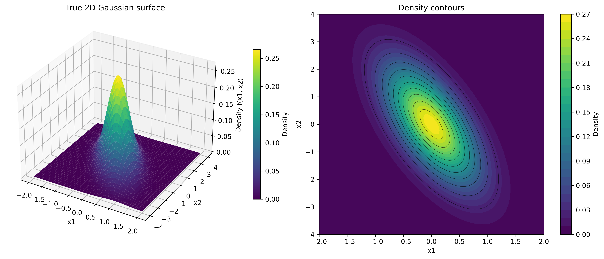
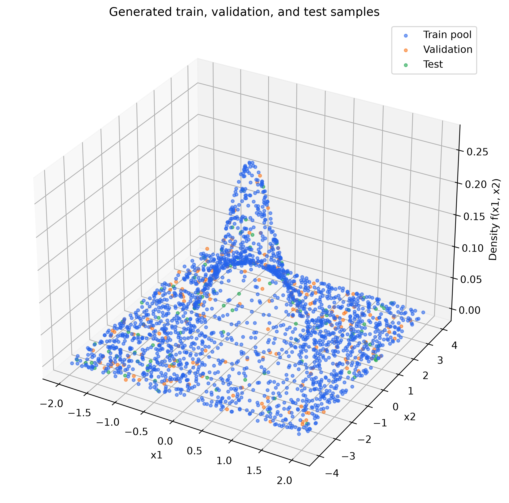
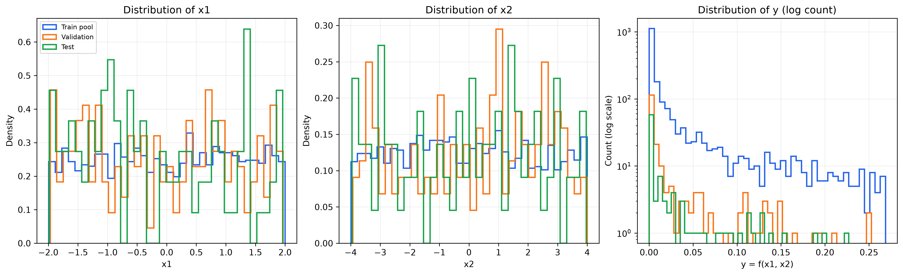

# Chương 2. Dữ liệu

> Bản thảo TV1. Các số liệu trong chương được sinh từ **data/train_pool.csv**, **data/val.csv**, **data/test.csv** và tổng hợp tại **results/eda/data_summary.csv**. Cập nhật lại nếu seed hoặc tập dữ liệu thay đổi.

## 2.1. Hàm mục tiêu và miền lấy mẫu

Bài toán xấp xỉ mật độ Gaussian hai chiều. Với đầu vào \(\mathbf{x}=(x_1,x_2)^T\), nhãn được tính trực tiếp từ:

\[
f(\mathbf{x})=\frac{1}{2\pi\sqrt{\det(C)}}\exp\!\left[-\frac{1}{2}(\mathbf{x}-\mu)^T C^{-1}(\mathbf{x}-\mu)\right],
\]

trong đó

\[
\mu=\begin{bmatrix}0\\0\end{bmatrix}, \qquad
C=\begin{bmatrix}0.3&-0.5\\-0.5&2.0\end{bmatrix}.
\]

Ta có \(\det(C)=0.35\), vì vậy giá trị cực đại tại \(\mathbf{x}=\mu\) là \(y_{\max}=1/(2\pi\sqrt{0.35})\approx0.2690\). Nhãn không nằm trong khoảng [0, 1] như ghi trên một số slide cũ. Ma trận hiệp phương sai có phần tử ngoài đường chéo âm, nên các đường đồng mức nghiêng theo phương chéo.

Mỗi điểm được lấy mẫu đều và độc lập trên hình chữ nhật \(x_1\in[-2,2]\), \(x_2\in[-4,4]\). Nhãn \(y=f(x_1,x_2)\) được tính bằng hàm Gaussian đã cài đặt; dữ liệu không thêm nhiễu.

## 2.2. Sinh và chia dữ liệu

Ba split được sinh bằng numpy.random.default_rng với seed riêng. Train pool được tạo một lần với 2.000 điểm; các mức A trong Thực nghiệm A lấy A dòng đầu của pool để tạo các tập con lồng nhau. Validation và test độc lập với train pool.

| Split | Số mẫu | Seed | Vai trò |
|---|---:|---:|---|
| Train pool | 2.000 | 2026 | Lấy tập con A = 200, 400, …, 2.000 |
| Validation | 200 | 2027 | Early stopping và chọn cấu hình |
| Test | 100 | 2028 | Chỉ đánh giá mô hình cuối sau khi chọn bằng validation |

Script **src/generate_data.py** ghi ba CSV cùng **data/meta.json**. Sinh lại hai lần cho cùng nội dung file; đã kiểm tra đủ số dòng, header, miền lấy mẫu, nhãn khớp hàm Gaussian và các split không có điểm trùng.

## 2.3. Tiền xử lý

Khi huấn luyện, đầu vào được scale bằng các biên miền đã biết: \(x_1/2\) và \(x_2/4\), đưa hai tọa độ về [-1, 1]. Nhãn được chia cho hằng số lý thuyết \(y_{\max}\approx0.2690\). Các hằng scale không được ước lượng từ dữ liệu nên không sử dụng thông tin validation/test. Khi báo cáo metric, dự đoán được đổi về thang y gốc.

## 2.4. Thống kê mô tả

Bảng dưới dùng độ lệch chuẩn tổng thể (ddof = 0). Tỷ lệ \(y<0.01\) được tính riêng cho từng split.

| Split | Biến | n | Min | Max | Mean | Std | Tỷ lệ y < 0.01 |
|---|---|---:|---:|---:|---:|---:|---:|
| Train pool | x1 | 2.000 | -1.9943 | 1.9991 | 0.0303 | 1.1518 | — |
| Train pool | x2 | 2.000 | -3.9952 | 3.9997 | -0.0288 | 2.2772 | — |
| Train pool | y | 2.000 | 8.90×10⁻¹⁴ | 0.2687 | 0.0314 | 0.0581 | 62.6% |
| Validation | x1 | 200 | -1.9680 | 1.9655 | -0.0461 | 1.1845 | — |
| Validation | x2 | 200 | -3.9313 | 3.9974 | 0.1674 | 2.2837 | — |
| Validation | y | 200 | 1.15×10⁻¹¹ | 0.2526 | 0.0264 | 0.0497 | 66.0% |
| Test | x1 | 100 | -1.9856 | 1.9595 | -0.2054 | 1.1847 | — |
| Test | x2 | 100 | -3.9585 | 3.9646 | -0.0555 | 2.3222 | — |
| Test | y | 100 | 4.54×10⁻¹³ | 0.2269 | 0.0268 | 0.0485 | 61.0% |

Mẫu được phủ gần hết miền lấy mẫu. Phân bố nhãn mất cân bằng rõ: khoảng 62.6% nhãn trong train pool nhỏ hơn 0.01, trong khi nhãn lớn nhất chỉ xuất hiện ở một vùng hẹp quanh tâm. Vì vậy MSE tuyệt đối cần được đọc cùng MAE/RMSE và các biểu đồ dự đoán; mô hình dự đoán gần 0 có thể có MSE nhỏ nhưng bỏ lỡ vùng đỉnh.

## 2.5. Hình EDA

**Hình 2.1.** Bề mặt Gaussian thật và các đường đồng mức trên miền lấy mẫu.

**Hình 2.2.** Scatter 3D của train pool, validation và test; màu được giữ nhất quán.

**Hình 2.3.** Histogram của \(x_1\), \(x_2\) và \(y\); trục đếm của \(y\) ở thang log để thấy các bin thưa.

## 2.6. Tệp tái lập

- Sinh split và metadata: **python src/generate_data.py**
- Tạo bảng thống kê và hình: **python src/data/eda.py**
- CSV nguồn: **data/train_pool.csv**, **data/val.csv**, **data/test.csv**
- Bảng thống kê: **results/eda/data_summary.csv**
