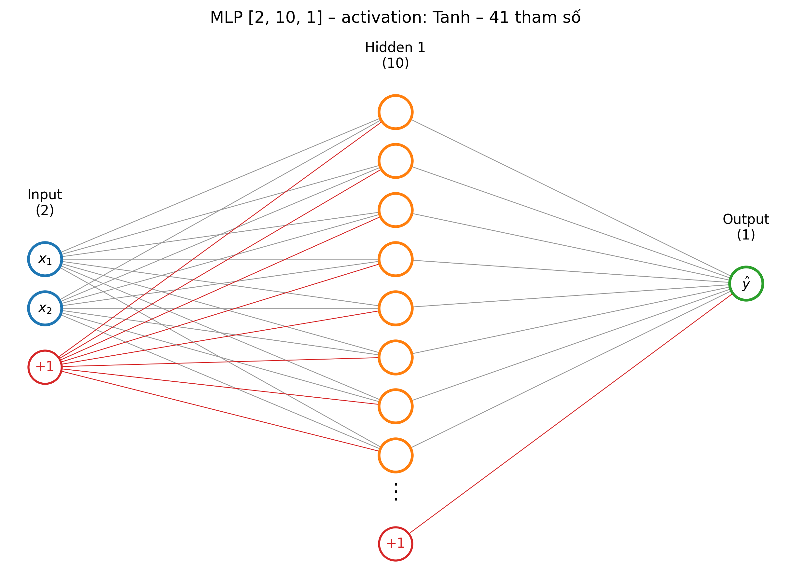
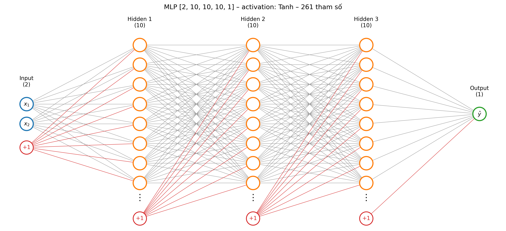
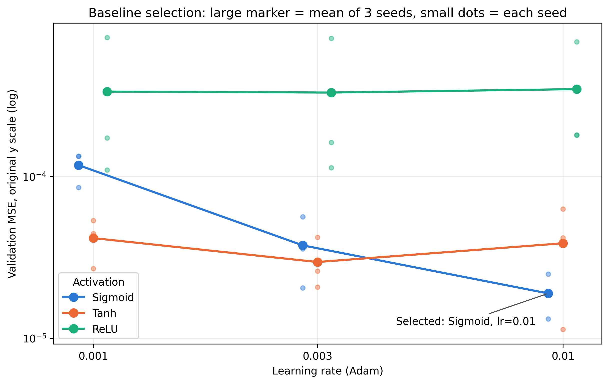
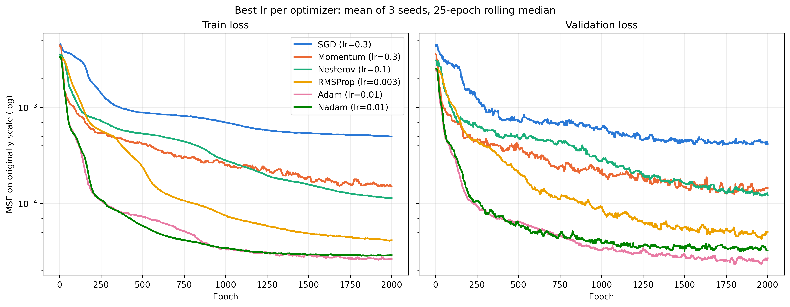

# Chương 3. Mô hình và cài đặt

> Bản thảo TV2. Mọi siêu tham số lấy từ **configs/baseline.json**; code tham chiếu theo đường dẫn trong repo. Cập nhật nếu baseline thay đổi (khi đó phải chạy lại A, B, C).

## 3.1. Kiến trúc MLP

Mô hình là mạng truyền thẳng nhiều tầng (MLP) với 2 đầu vào \((x_1, x_2)\) và 1 đầu ra \(\hat y\). Lớp **MLP** trong **src/model/mlp.py** nhận danh sách số nơ-ron của từng tầng ẩn (hidden_sizes) và tên hàm kích hoạt, nên cùng một lớp dùng được cho cả ba nhóm thí nghiệm: A giữ [10], B đổi [B], C đổi [10]×C.

**Hình 3.1.** Kiến trúc baseline [2, 10, 1], kích hoạt sigmoid, 41 tham số (vẽ từ model thật bằng **src/visual/draw_mlp.py**).



**Hình 3.2.** Ví dụ mạng sâu dùng trong Thực nghiệm C: ba tầng ẩn, mỗi tầng 10 nơ-ron.



Lan truyền thuận cho tầng \(l=1,\ldots,L-1\):

\[
\mathbf z^{(l)} = W^{(l)}\mathbf a^{(l-1)} + \mathbf b^{(l)},\qquad \mathbf a^{(l)} = \sigma(\mathbf z^{(l)}),\qquad \mathbf a^{(0)}=\tilde{\mathbf x},
\]

với \(\tilde{\mathbf x} = (x_1/2,\; x_2/4)\) là đầu vào đã scale và \(\sigma(z)=1/(1+e^{-z})\). Tầng cuối **tuyến tính**: \(\hat y = W^{(L)}\mathbf a^{(L-1)} + b^{(L)}\). Đây là bài toán hồi quy, nên không đặt sigmoid ở đầu ra; dự đoán trên thang đã scale được nhân lại với \(y_{\max}\approx0.2690\) trước khi tính chỉ số.

Số tham số: mạng một tầng [2, B, 1] có \(2B + B + B + 1 = 4B+1\) tham số; mạng C tầng, mỗi tầng 10 nơ-ron, có \(30 + 110(C-1) + 11\), tức 41, 151, 261, 371 với C = 1…4. Hàm **n_params** đếm trực tiếp từ model và được kiểm thử khớp công thức trong **tests/test_trainer.py**.

## 3.2. Hàm mất mát và lan truyền ngược

Hàm mất mát là MSE trên một batch N mẫu (thang đã scale):

\[
L = \frac1N\sum_{n=1}^{N}(\hat y_n - y_n)^2 .
\]

Gradient được tính ngược từ đầu ra:

\[
\delta^{(L)} = \frac{2}{N}(\hat{\mathbf y}-\mathbf y),\qquad
\delta^{(l)} = \big(W^{(l+1)\,T}\delta^{(l+1)}\big)\odot\sigma'(\mathbf z^{(l)}),\qquad
\frac{\partial L}{\partial W^{(l)}} = \delta^{(l)}\,\mathbf a^{(l-1)\,T},\qquad
\frac{\partial L}{\partial \mathbf b^{(l)}} = \sum_n \delta^{(l)}_n ,
\]

với \(\sigma'(z) = \sigma(z)\,(1-\sigma(z)) \le 0.25\). Cận 0.25 này là lý do mạng sigmoid sâu có thể bị **vanishing gradient**: mỗi tầng nhân thêm một hệ số nhỏ hơn hoặc bằng 0.25. Thực nghiệm C ghi chuẩn gradient từng lớp để kiểm tra điều này bằng số liệu, không chỉ suy luận (mục 4.4).

PyTorch tính các gradient trên bằng autograd. Để chắc autograd và công thức khớp nhau, **tests/test_backprop.py** làm hai việc: (1) tính tay bằng NumPy cho mạng 2→2→1 và so với autograd (sai khác < 10⁻¹²); (2) dùng **torch.autograd.gradcheck** so autograd với đạo hàm số (sai phân hữu hạn) ở độ chính xác float64.

## 3.3. Tối ưu bằng Adam

Với gradient \(g_t\) tại bước t, Adam cập nhật

\[
m_t=\beta_1 m_{t-1}+(1-\beta_1)g_t,\quad v_t=\beta_2 v_{t-1}+(1-\beta_2)g_t^2,\quad
\hat m_t=\frac{m_t}{1-\beta_1^t},\quad \hat v_t=\frac{v_t}{1-\beta_2^t},\quad
\theta_t=\theta_{t-1}-\eta\,\frac{\hat m_t}{\sqrt{\hat v_t}+\varepsilon},
\]

với mặc định PyTorch \(\beta_1=0.9,\ \beta_2=0.999,\ \varepsilon=10^{-8}\) và learning rate \(\eta = 0.01\) chọn bằng validation (mục 3.5).

## 3.4. Cài đặt PyTorch

**Dữ liệu.** **make_loader** trong **src/data/dataset.py** scale x, y bằng hằng số của bài toán, gói vào **TensorDataset** và tạo **DataLoader** batch 32. Loader train xáo trộn với **torch.Generator** gắn seed, nên thứ tự batch tái lập được; loader validation không xáo.

**Vòng huấn luyện** (**src/engine/trainer.py**) giữ đúng thứ tự đề yêu cầu:

```python
def train_one_epoch(model, loader, opt, crit):
    model.train()
    tot = 0.0
    for xb, yb in loader:
        opt.zero_grad()
        pred = model(xb)
        assert pred.shape == yb.shape          # (N,1) vs (N,) sẽ broadcast thành (N,N)
        loss = crit(pred, yb)
        loss.backward()
        opt.step()
        tot += loss.item() * xb.size(0)        # trung bình theo số mẫu, batch cuối nhỏ hơn
    return tot / len(loader.dataset)
```

Các điểm quan trọng:

- **model.train() / model.eval()** chuyển chế độ; mạng không có Dropout/BatchNorm nhưng vẫn đặt đúng ngữ cảnh. Hàm **validate** chạy dưới **@torch.no_grad()** nên không xây đồ thị tính toán, tiết kiệm bộ nhớ và thời gian.
- **forward trả shape (N,)** (squeeze(-1)) và có assert shape. Nếu dự đoán có shape (N,1) còn nhãn (N,), **MSELoss** broadcast thành ma trận N×N, loss vẫn giảm nhưng mô hình học ra hằng số.
- Loss epoch được cộng theo **trọng số kích thước batch**, vì batch cuối có thể nhỏ hơn 32.

**Early stopping và checkpoint** (hàm **fit**): sau mỗi epoch tính val loss; nếu tốt hơn mức tốt nhất thì lưu **copy.deepcopy(model.state_dict())** (state_dict trả về tham chiếu, không deepcopy thì "bản tốt nhất" sẽ bị ghi đè theo trọng số hiện tại). Nếu val loss không cải thiện sau **patience = 200** epoch thì dừng, nạp lại trọng số tốt nhất và ghi **best.pt**. **fit** không nhận dữ liệu test; test chỉ được tính khi chạy **run_experiment.py --eval-test** ở bước cuối.

**Nhật ký.** Mỗi epoch ghi train loss, val loss và chuẩn gradient \(\lVert\partial L/\partial W^{(l)}\rVert\) của từng lớp (ở batch cuối của epoch) vào **history.csv**. Mỗi lần chạy lưu **config.json**, **history.csv**, **metrics.json**, **best.pt** trong **results/&lt;exp&gt;/&lt;giá trị&gt;/seed_&lt;k&gt;/**; **run_experiment.py** gom tất cả vào **summary.csv**.

**Tái lập.** **set_seed** cố định seed của random, NumPy và PyTorch trước khi khởi tạo mô hình; **torch.set_num_threads(1)** cho mọi lần chạy để thời gian huấn luyện so sánh được với nhau. Trên cùng một máy, chạy lại cùng cấu hình cho ra cùng số: run A=1000 của Thực nghiệm A trùng khớp từng chữ số với run sigmoid/lr 0.01 trong lưới chọn baseline, và run C=1 trùng khớp với run B=10. Giữa hai máy, kết quả lệch rất nhỏ: cùng cấu hình baseline, validation MSE của Thực nghiệm A và Thực nghiệm C chênh tương đối dưới 0.01%.

## 3.5. Siêu tham số baseline

Baseline được chọn bằng lưới 3 learning rate × 3 hàm kích hoạt × 3 seed, **chỉ dựa trên validation MSE** (Hình 3.3; bảng đầy đủ ở mục 4.2 và **results/grid_baseline/summary.csv**), rồi đóng băng trong **configs/baseline.json**. A, B, C chỉ đổi một yếu tố so với Bảng 3.1.

**Hình 3.3.** Validation MSE của lưới chọn baseline theo learning rate và hàm kích hoạt; điểm lớn là trung bình 3 seed, điểm nhỏ là từng seed (sinh bằng **python src/summarize_grid_baseline.py**).



Sigmoid với lr 0.01 có mean validation MSE thấp nhất (1.89e-5 ± 5.89e-6) nên được chọn. Tanh với lr 0.003 đứng thứ hai (2.96e-5 ± 1.11e-5); khoảng ± std của hai cấu hình chồng nhau, nên đây là lựa chọn theo mean, chưa chứng minh sigmoid tốt hơn tanh. ReLU có mean cao hơn khoảng 17 lần và phân tán mạnh giữa các seed (tốt nhất 3.30e-4 ± 3.35e-4).

**Bảng 3.1.** Siêu tham số baseline.

| Siêu tham số | Giá trị |
|---|---|
| Kiến trúc | [2, 10, 1], đầu ra tuyến tính |
| Hàm kích hoạt tầng ẩn | sigmoid |
| Khởi tạo trọng số | mặc định của nn.Linear (Kaiming-uniform, a = √5) |
| Hàm mất mát | MSELoss (trên thang đã scale) |
| Optimizer | Adam, lr = 0.01, β = (0.9, 0.999) |
| Batch size | 32 |
| Số mẫu train | A = 1000 (trừ Thực nghiệm A) |
| Số epoch tối đa | 2000 |
| Điều kiện dừng | val loss không giảm sau 200 epoch; nạp checkpoint tốt nhất theo val |
| Seed huấn luyện | 0, 1, 2 (khởi tạo trọng số và thứ tự batch) |
| Seed dữ liệu | train pool 2026, validation 2027, test 2028 |

### Kiểm tra lựa chọn optimizer

Lưới trên chỉ xét Adam, nên nhóm so sánh thêm sáu optimizer: SGD, Momentum (0.9), Nesterov (0.9), RMSProp, Adam, Nadam. Kiến trúc, sigmoid, A = 1000, batch 32 và seed giữ nguyên như baseline. Mỗi optimizer dò riêng 7 learning rate từ 0.001 đến 1.0 (6 × 7 × 3 = 126 run), vì lr tốt của optimizer này có thể rất tệ với optimizer khác. Early stopping được tắt (patience 2000) để mọi đường đủ 2.000 epoch. Lr tốt nhất chọn theo mean validation MSE; tập test không được dùng. Nguồn: **results/grid_optimizer/aggregate.csv**, sinh bằng **python src/summarize_optimizer.py**.

**Bảng 3.2.** Kết quả ở lr tốt nhất của từng optimizer (mean ± std, 3 seed).

| Optimizer | lr tốt nhất | Validation MSE | Epoch tốt nhất |
|---|---:|---:|---:|
| Adam | 0.01 | 1.88e-5 ± 5.91e-6 | 1906 |
| Nadam | 0.01 | 2.51e-5 ± 1.20e-5 | 1702 |
| RMSProp | 0.003 | 3.38e-5 ± 2.12e-5 | 1961 |
| Momentum | 0.3 | 8.35e-5 ± 6.13e-5 | 1929 |
| Nesterov | 0.1 | 1.01e-4 ± 3.84e-5 | 1949 |
| SGD | 0.3 | 3.57e-4 ± 7.69e-5 | 1838 |

**Hình 3.4.** Train loss và validation loss theo epoch ở lr tốt nhất của từng optimizer: trung bình 3 seed, làm mượt bằng trung vị trượt 25 epoch.



Adam có mean thấp nhất, nhưng khoảng ± std của Adam, Nadam và RMSProp chồng nhau, nên 3 seed chưa tách được ba optimizer này. Momentum và Nesterov có mean cao hơn Adam 4–5 lần, SGD cao hơn khoảng 19 lần. Vì không có optimizer nào tốt hơn Adam, nhóm giữ nguyên baseline và không phải chạy lại A, B, C. Lưới này cũng thử Adam ở lr lớn hơn mức 0.01 vốn nằm ở biên lưới baseline: lr 0.03 cho 5.18e-5 ± 4.71e-5, nên không có dấu hiệu lr tốt hơn nằm ngoài lưới baseline.

Hai hạn chế: sigmoid được chọn trong lưới chỉ dùng Adam, nên so sánh có thể hơi có lợi cho Adam; và phép so sánh chỉ làm trên mạng một tầng ẩn, nên chưa cho biết optimizer ảnh hưởng thế nào đến mạng sâu ở Thực nghiệm C.

## 3.6. Môi trường

**Bảng 3.3.** Môi trường chạy B, C và so sánh optimizer. Lưới baseline và Thực nghiệm A chạy trên một máy khác (xem phần Tái lập ở mục 3.4).

| Thành phần | Phiên bản |
|---|---|
| Hệ điều hành | Windows 11 Enterprise 10.0.22631 |
| CPU | AMD64 Family 25 Model 116 (16 luồng logic; huấn luyện dùng 1 luồng) |
| Python | 3.12.10 |
| PyTorch | 2.6.0+cu124 (chạy trên CPU) |
| NumPy / Matplotlib | 2.5.2 / 3.10.1 |

Mạng chỉ có 41–373 tham số nên chạy trên CPU là đủ; GPU không làm nhanh hơn với batch 32.

## 3.7. Lệnh chạy

```
python src/run_experiment.py --config configs/baseline.json
python src/run_experiment.py --config configs/demo.json       # demo < 1 phút: 1 seed, 300 epoch
pytest -q tests/test_backprop.py tests/test_trainer.py         # kiểm tra backprop, checkpoint, tái lập
```
