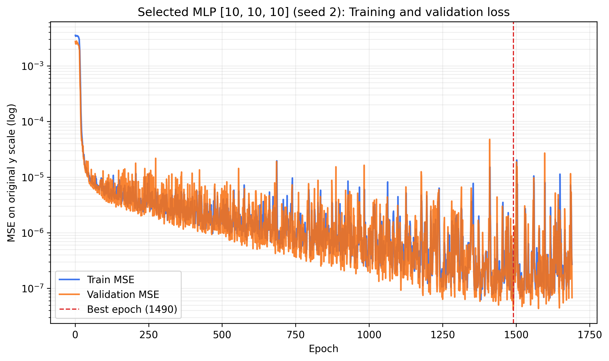
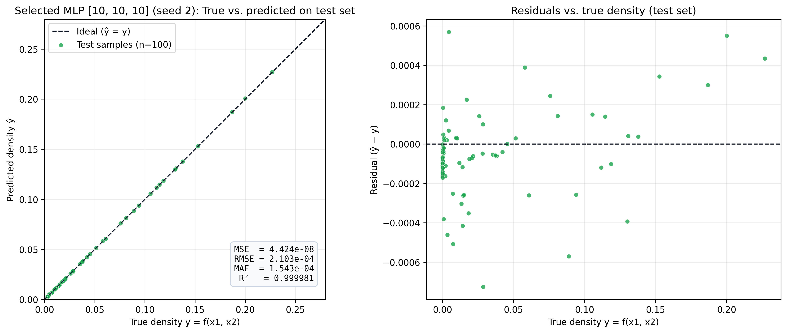
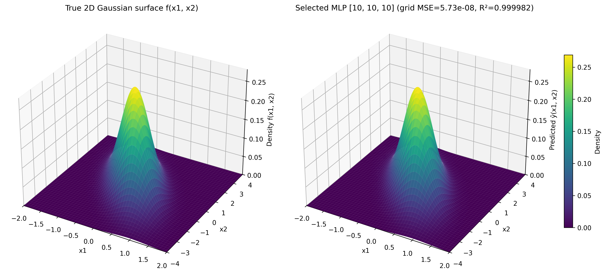
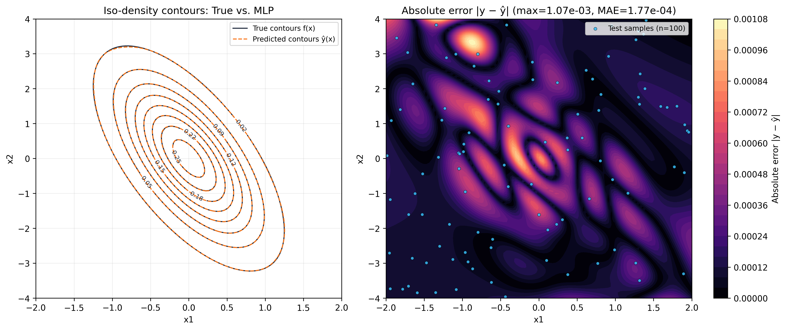

# Mục 4.5 – Lựa chọn mô hình cuối và đánh giá trên tập Test

> Bản thảo TV3. Mọi chỉ số được tính trên thang $y$ gốc. Nguồn số liệu: `results/summary_all.csv`, `results/final/summary.csv`, `results/final/aggregate.csv`, `results/final/metrics.json`, sinh tự động bằng lệnh `python src/make_report_assets.py`.

## 1. Quy trình lựa chọn mô hình cuối (Chỉ dựa trên Validation)

Để tuân thủ nghiêm ngặt nguyên tắc chống rò rỉ dữ liệu (data leakage), tập `test.csv` ($100$ mẫu độc lập, `seed = 2028`) không tham gia bất kỳ quyết định nào: dò siêu tham số baseline, chọn checkpoint và chọn cấu hình đều chỉ dùng validation. Số test của A, B, C trong các mục 4.2–4.4 là hậu kiểm, chỉ để trình bày. Mô hình cuối là cấu hình có **Validation MSE trung bình qua 3 seed thấp nhất** trong toàn bộ 53 cấu hình của `results/summary_all.csv` (gồm cả các đối chứng `expA_steps`, `expB_wide`, `expB_A200`); quy tắc này được kiểm tra tự động bởi `tests/test_config_evidence.py`, nên nếu `configs/final.json` không khớp với log thì `pytest` báo lỗi:

1. **Trong Thực nghiệm A** ($C = 1, B = 10$, thay đổi $A \in \{200 \dots 2000\}$): Cấu hình tốt nhất đạt tại $A = 1600$ với Validation MSE $= 1.52 \times 10^{-5} \pm 1.42 \times 10^{-6}$ (tại $A = 1000$ đạt $1.89 \times 10^{-5} \pm 5.89 \times 10^{-6}$).
2. **Trong Thực nghiệm B** ($C = 1, A = 1000$, thay đổi độ rộng $B$): Trong dải $B = 1 \dots 10$, tốt nhất là $B = 10$ ($41$ tham số, Validation MSE $= 1.89 \times 10^{-5} \pm 5.89 \times 10^{-6}$). Khi mở rộng tới $B = 16, 32, 64$ và $B = 93$ ($373$ tham số), mạng 1 tầng ẩn tốt nhất đạt Validation MSE $= 1.46 \times 10^{-6} \pm 4.32 \times 10^{-7}$ ($B = 93$). Các đối chứng ở $A = 200$ và đối chứng cùng ngân sách bước của A đều có Validation MSE cao hơn ($\ge 9.2 \times 10^{-6}$).
3. **Trong Thực nghiệm C** ($A = 1000$, mỗi tầng $10$ nơ-ron, thay đổi độ sâu $C \in \{1, 2, 3, 4\}$):
   - $C = 1$ (`[10]`, $41$ tham số): Validation MSE $= 1.89 \times 10^{-5} \pm 5.89 \times 10^{-6}$
   - $C = 2$ (`[10, 10]`, $151$ tham số): Validation MSE $= 1.05 \times 10^{-7} \pm 2.70 \times 10^{-8}$
   - **$C = 3$ (`[10, 10, 10]`, $261$ tham số): Validation MSE $= 6.02 \times 10^{-8} \pm 2.07 \times 10^{-8}$** *(thấp nhất toàn bộ không gian khảo sát)*
   - $C = 4$ (`[10, 10, 10, 10]`, $371$ tham số): Validation MSE $= 9.21 \times 10^{-8} \pm 8.22 \times 10^{-8}$

**Quyết định lựa chọn:** Nhóm chọn cấu hình **$C = 3$ tầng ẩn `[10, 10, 10]`** ($261$ tham số, hàm kích hoạt `sigmoid`, Adam `lr = 0.01`, huấn luyện trên $A = 1000$ mẫu) làm kiến trúc mô hình cuối vì đạt Validation MSE trung bình thấp nhất và độ lệch chuẩn giữa các seed nhỏ hơn $C = 4$. Trong 3 seed của cấu hình này, checkpoint có Validation MSE thấp nhất là **`seed = 2`** (đạt $\text{Val MSE} = 4.14 \times 10^{-8}$ tại `best_epoch = 1490`), được trích xuất lưu tại `results/final/best.pt`.

---

## 2. Kết quả đánh giá trên Tập Test độc lập và Lưới dày $100 \times 100$

Vì tập `test.csv` chỉ có $100$ điểm lấy mẫu ngẫu nhiên (trong đó chỉ có $11$ điểm có mật độ $y > 0.1$ quanh vùng đỉnh), nhóm thực hiện đánh giá đồng thời trên:
1. **Tập Test độc lập (`data/test.csv`, $N = 100$ mẫu)** theo đúng yêu cầu đề bài.
2. **Lưới điểm đều $100 \times 100$ ($10.000$ điểm)** phủ kín toàn bộ miền $[-2, 2] \times [-4, 4]$ để kiểm định chất lượng xấp xỉ mặt cong toàn cục mà không bị thiên lệch bởi vị trí bốc mẫu ngẫu nhiên.

**Bảng 4.5.1.** So sánh kết quả đánh giá cuối trên tập Test ($N = 100$) và trên lưới dày $100 \times 100$ ($N = 10.000$) giữa baseline dự đoán trung bình, mạng 1 tầng ẩn và mô hình được chọn (mean ± std qua 3 seed, thang $y$ gốc).

| Mô hình / Cấu hình | Tham số | Validation MSE | Test MSE ($N=100$) | Test MAE ($N=100$) | Test RMSE ($N=100$) | Test $R^2$ | Grid MSE ($100\times 100$) | Grid Max $\|y-\hat{y}\|$ |
|---|---:|---:|---:|---:|---:|---:|---:|---:|
| Dự đoán hằng số ($\bar{y}_{\text{train}}$) | 1 | 2.49e-3 | 2.37e-3 | 3.64e-2 | 4.87e-2 | −0.00734 | — | — |
| Baseline $C=1$ `[10]` (3 seed) | 41 | 1.89e-5 ± 5.89e-6 | 2.28e-5 ± 1.43e-5 | 3.53e-3 ± 1.05e-3 | 4.63e-3 ± 1.42e-3 | 0.99030 ± 0.00609 | 2.53e-5 ± 7.11e-6 | 2.47e-2 ± 1.94e-3 |
| Đối chứng 1 tầng $B=93$ `[93]` (3 seed) | 373 | 1.46e-6 ± 4.32e-7 | 1.41e-6 ± 2.01e-7 | 8.83e-4 ± 2.00e-5 | 1.18e-3 ± 8.65e-5 | 0.99940 ± 0.00009 | 1.53e-6 ± 3.27e-7 | 7.34e-3 ± 3.03e-3 |
| **Mô hình chọn $C=3$ `[10,10,10]` (3 seed)** | **261** | **6.02e-8 ± 2.07e-8** | **7.13e-8 ± 2.36e-8** | **1.94e-4 ± 3.43e-5** | **2.64e-4 ± 4.70e-5** | **0.999970 ± 0.000010** | **7.34e-8 ± 1.40e-8** | **1.15e-3 ± 6.87e-5** |
| **Checkpoint tốt nhất (`seed = 2`, `best.pt`)** | **261** | **4.14e-8** | **4.42e-8** | **1.54e-4** | **2.10e-4** | **0.999981** | **5.73e-8** | **1.07e-3** |

---

## 3. Trực quan hóa chất lượng xấp xỉ của mô hình cuối

**Hình 4.5.1.** Quá trình hội tụ Train MSE và Validation MSE theo epoch của checkpoint được chọn (`MLP [10, 10, 10]`, `seed = 2`, đạt cực tiểu validation tại epoch $1490$).

**Hình 4.5.2.** Trái: Biểu đồ phân tán giữa giá trị thật $y$ và giá trị dự đoán $\hat{y}$ trên $100$ mẫu tập Test kèm đường lý tưởng $\hat{y} = y$. Phải: Phân bố phần dư $(\hat{y} - y)$ theo giá trị mật độ thật $y$.

**Hình 4.5.3.** So sánh trực quan bề mặt 3D hàm mật độ Gaussian thật $f(x_1, x_2)$ (trái) và bề mặt xấp xỉ bởi mạng `MLP [10, 10, 10]` (phải) trên cùng hệ trục $z \in [0, 0.28]$.

**Hình 4.5.4.** Trái: Đường đồng mức (iso-density contours) của hàm thật (nét liền) và hàm xấp xỉ (nét đứt). Phải: Bản đồ nhiệt sai số tuyệt đối $|y(x_1, x_2) - \hat{y}(x_1, x_2)|$ trên toàn miền kèm vị trí $100$ mẫu Test.

---

## 4. Phân tích kết quả và Giới hạn của đánh giá

1. **Khả năng tổng quát hóa vượt trội và nhất quán giữa Validation – Test – Grid:**
   - Trên tập Test độc lập, cấu hình được chọn `C=3 [10, 10, 10]` đạt $\text{Test MSE} = 7.13 \times 10^{-8} \pm 2.36 \times 10^{-8}$ ($\text{RMSE} = 2.64 \times 10^{-4}$, $\text{MAE} = 1.94 \times 10^{-4}$, $R^2 = 0.999970$), giảm sai số hơn **33.000 lần** so với dự đoán trung bình và giảm **320 lần** so với cấu hình baseline 1 tầng ẩn `[10]`.
   - Đáng chú ý, $\text{Test MSE}$ ($7.13 \times 10^{-8}$) và $\text{Grid MSE}$ trên lưới dày $10.000$ điểm ($7.34 \times 10^{-8}$) rất sát với $\text{Validation MSE}$ ($6.02 \times 10^{-8}$). Điều này chứng minh việc chọn checkpoint theo tập validation không gây quá khớp lên tập validation.
2. **Chất lượng hình học trên miền $(x_1, x_2)$:**
   - Trên Hình 4.5.2 (trái), toàn bộ $100$ điểm test nằm trùng khít lên đường phân giác $\hat{y} = y$ trên suốt dải giá trị từ $0$ đến đỉnh $0.269$.
   - Trên Hình 4.5.4 (trái), các elip đồng mức nghiêng góc $\rho \approx -0.645$ từ mức mật độ thấp ($0.02$) tới sát đỉnh ($0.25$) của mạng MLP chồng khít lên đường đồng mức lý thuyết.
   - Bản đồ nhiệt sai số tuyệt đối (Hình 4.5.4 phải) cho thấy sai số lớn nhất toàn miền chỉ ở mức $\max |y - \hat{y}| \approx 1.07 \times 10^{-3}$ (tương đương $< 0.4\%$ chiều cao đỉnh hàm $y_{\max} = 0.2690$), xuất hiện cục bộ ở vùng sườn dốc lớn nhất quanh đỉnh và một góc biên $(x_1 \approx -0.8, x_2 \approx 3.3)$ nơi mật độ điểm huấn luyện thưa hơn.
3. **Giới hạn của tập Test $100$ mẫu và lý do cần lưới dày bổ sung:**
   - Do lấy mẫu đều trên hình chữ nhật $[-2, 2] \times [-4, 4]$ diện tích $32$, vùng đỉnh elip có diện tích nhỏ nên trong $100$ mẫu test chỉ có **$11$ mẫu có $y > 0.10$** và **$61$ mẫu có $y < 0.01$** (thấy rõ qua cụm điểm dày đặc gần $y = 0$ trên Hình 4.5.2 phải).
   - Nếu chỉ nhìn vào MSE trên $100$ mẫu ngẫu nhiên, chỉ số có thể bị chi phối bởi vùng nền $y \approx 0$. Việc kết hợp thêm kiểm định trên lưới đều $100 \times 100$ và bản đồ $|y - \hat{y}|$ giúp khắc phục triệt để hạn chế này.

