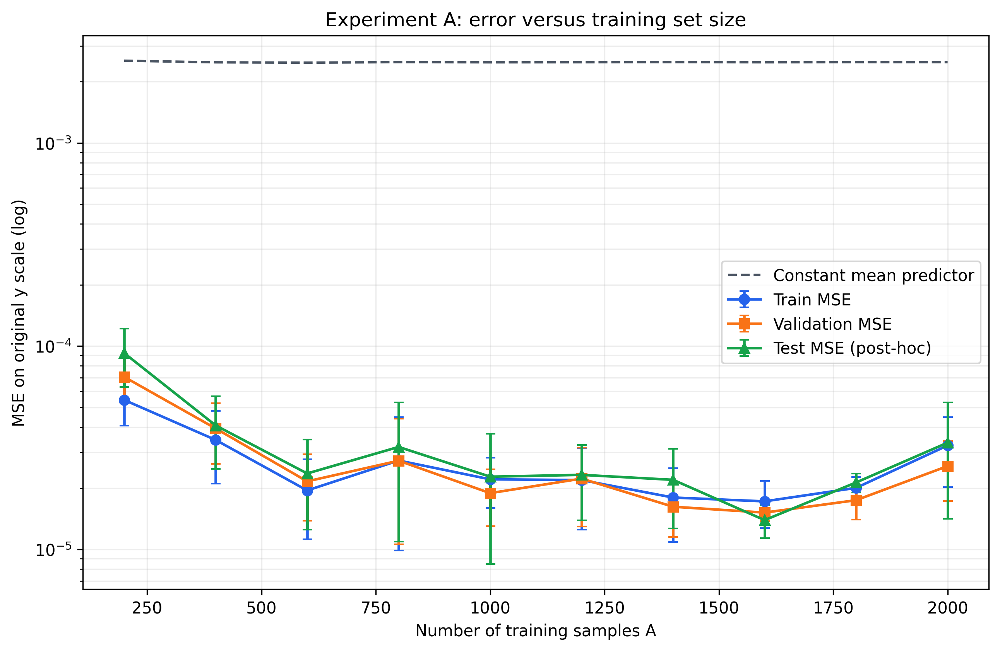
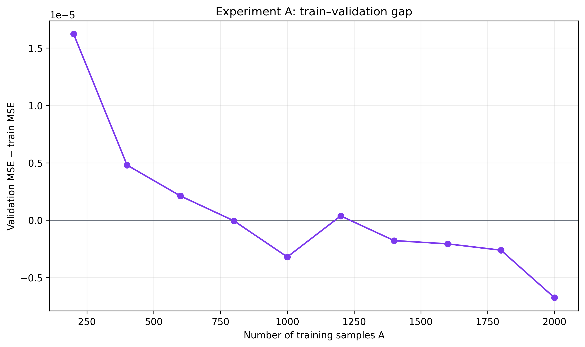
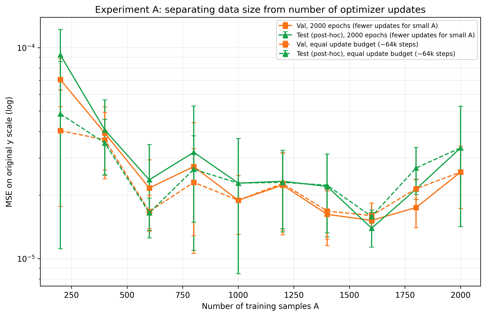

# Mục 4.2 – Thực nghiệm A: ảnh hưởng của số mẫu huấn luyện

> Kết quả tổng hợp từ 30 run (10 giá trị A × 3 seed) và 30 run đối chứng cùng ngân sách bước cập nhật. Mọi metric dưới đây ở thang y gốc; std là độ lệch chuẩn mẫu giữa ba seed. Nguồn: `results/expA/summary.csv`, `results/expA_steps/summary.csv` (mỗi run 1 dòng), log `run.log` và `posthoc_test.log`; bảng sinh tự động ở `report/tables/expA.md`, `report/tables/expA_steps.md`.

## Thiết kế

Thay đổi số mẫu huấn luyện \(A\in\{200,400,\ldots,2000\}\). Mỗi mức A lấy A mẫu đầu của cùng train pool 2.000 mẫu. Các tập con vì vậy lồng nhau; validation cố định 200 mẫu. Thực hiện ba seed huấn luyện (0, 1, 2), giữ nguyên kiến trúc và các siêu tham số còn lại.

Baseline được chọn bằng lưới 3 learning rate × 3 activation × 3 seed, chỉ trên validation. Mean validation MSE thấp nhất là sigmoid, learning rate 0.01; cấu hình được khóa trong `configs/baseline.json` và dùng cố định trong `configs/expA.json`. Bảng tổng hợp đủ 27 run nằm ở `results/grid_baseline/summary.csv`.

| Activation | Learning rate | Validation MSE (mean ± std, 3 seed) |
|---|---:|---:|
| Sigmoid | 0.01 | 1.8908e-5 ± 5.8935e-6 |
| Tanh | 0.003 | 2.9563e-5 ± 1.1088e-5 |
| Sigmoid | 0.003 | 3.7491e-5 ± 1.8026e-5 |
| Tanh | 0.01 | 3.8619e-5 ± 2.5905e-5 |
| Tanh | 0.001 | 4.1553e-5 ± 1.3443e-5 |
| Sigmoid | 0.001 | 1.1747e-4 ± 2.7726e-5 |
| ReLU | 0.003 | 3.3040e-4 ± 3.3453e-4 |
| ReLU | 0.001 | 3.3498e-4 ± 3.3700e-4 |
| ReLU | 0.01 | 3.4692e-4 ± 2.8886e-4 |

Thực nghiệm A chạy với Adam, batch size 32, tối đa 2.000 epoch và early stopping theo validation loss với patience 200. Mỗi run lưu cấu hình, history, metric và best checkpoint. Các giá trị này ban đầu được chọn theo thông lệ, sau đó được kiểm chứng: Adam thắng 5 optimizer khác (`results/grid_optimizer/`), batch 32 cho validation MSE thấp nhất trong {16, 32, 64, 128} (`results/grid_batch/`, chênh lệch nhỏ hơn std giữa seed), và patience 200 chỉ kém chạy đủ 2.000 epoch 0,7% validation MSE (`results/stopping/patience_sim.csv`, `figures/stopping_patience.png`).

Báo cáo train/validation MSE, MAE, RMSE trên thang y gốc dưới dạng mean ± độ lệch chuẩn qua seed. Đường cong A hiển thị error bar và so sánh với hằng số dự đoán bằng trung bình nhãn của từng tập train con. Test không tham gia chọn baseline, checkpoint hay cấu hình. Các cột test là **hậu kiểm**: `src/posthoc_test.py` nạp lại `best.pt` đã đóng băng của từng run và đo trên `test.csv`, chỉ để trình bày đủ ba đường train/validation/test theo yêu cầu đề.

## Kết quả

| A | Train MSE | Validation MSE | Test MSE *(hậu kiểm)* | Train MAE | Validation MAE | Test MAE *(hậu kiểm)* | Validation RMSE | Test RMSE *(hậu kiểm)* |
|---:|---:|---:|---:|---:|---:|---:|---:|---:|
| 200 | 5.43e-5 ± 1.37e-5 | 7.06e-5 ± 1.80e-5 | 9.24e-5 ± 2.95e-5 | 5.64e-3 ± 9.26e-4 | 6.26e-3 ± 8.86e-4 | 6.92e-3 ± 1.10e-3 | 8.35e-3 ± 1.10e-3 | 9.52e-3 ± 1.61e-3 |
| 400 | 3.45e-5 ± 1.35e-5 | 3.93e-5 ± 1.30e-5 | 4.07e-5 ± 1.59e-5 | 4.51e-3 ± 7.99e-4 | 4.73e-3 ± 8.25e-4 | 4.97e-3 ± 8.38e-4 | 6.21e-3 ± 1.07e-3 | 6.31e-3 ± 1.20e-3 |
| 600 | 1.95e-5 ± 8.27e-6 | 2.16e-5 ± 7.77e-6 | 2.36e-5 ± 1.11e-5 | 3.39e-3 ± 6.25e-4 | 3.56e-3 ± 6.17e-4 | 3.61e-3 ± 8.80e-4 | 4.60e-3 ± 8.10e-4 | 4.77e-3 ± 1.15e-3 |
| 800 | 2.74e-5 ± 1.75e-5 | 2.73e-5 ± 1.67e-5 | 3.19e-5 ± 2.10e-5 | 3.99e-3 ± 1.32e-3 | 4.05e-3 ± 1.35e-3 | 4.36e-3 ± 1.54e-3 | 5.07e-3 ± 1.55e-3 | 5.46e-3 ± 1.76e-3 |
| 1000 | 2.21e-5 ± 6.15e-6 | 1.89e-5 ± 5.89e-6 | 2.28e-5 ± 1.43e-5 | 3.63e-3 ± 5.97e-4 | 3.35e-3 ± 5.64e-4 | 3.53e-3 ± 1.05e-3 | 4.31e-3 ± 6.83e-4 | 4.63e-3 ± 1.42e-3 |
| 1200 | 2.19e-5 ± 9.43e-6 | 2.23e-5 ± 9.32e-6 | 2.33e-5 ± 9.37e-6 | 3.58e-3 ± 6.29e-4 | 3.56e-3 ± 6.52e-4 | 3.72e-3 ± 6.70e-4 | 4.66e-3 ± 9.49e-4 | 4.76e-3 ± 9.34e-4 |
| 1400 | 1.80e-5 ± 7.14e-6 | 1.62e-5 ± 4.69e-6 | 2.20e-5 ± 9.31e-6 | 3.27e-3 ± 6.11e-4 | 3.13e-3 ± 3.34e-4 | 3.52e-3 ± 7.82e-4 | 4.00e-3 ± 5.66e-4 | 4.62e-3 ± 9.53e-4 |
| 1600 | 1.72e-5 ± 4.48e-6 | 1.52e-5 ± 1.42e-6 | 1.39e-5 ± 2.59e-6 | 3.28e-3 ± 2.69e-4 | 3.06e-3 ± 9.08e-5 | 2.94e-3 ± 2.37e-4 | 3.89e-3 ± 1.81e-4 | 3.72e-3 ± 3.40e-4 |
| 1800 | 2.01e-5 ± 2.64e-6 | 1.75e-5 ± 3.47e-6 | 2.13e-5 ± 2.28e-6 | 3.38e-3 ± 2.43e-4 | 3.20e-3 ± 3.33e-4 | 3.48e-3 ± 1.73e-4 | 4.16e-3 ± 4.28e-4 | 4.62e-3 ± 2.45e-4 |
| 2000 | 3.24e-5 ± 1.22e-5 | 2.57e-5 ± 8.43e-6 | 3.35e-5 ± 1.93e-5 | 4.26e-3 ± 7.38e-4 | 3.91e-3 ± 5.95e-4 | 4.37e-3 ± 1.18e-3 | 5.03e-3 ± 8.15e-4 | 5.64e-3 ± 1.60e-3 |

## Hình và nhận xét

**Hình 4.2.1.** Train, validation và test (hậu kiểm) MSE theo số mẫu A, error bar ± std qua 3 seed.

**Hình 4.2.2.** Khoảng cách validation − train MSE theo A.

- Validation MSE giảm từ 7.06e-5 tại A=200 xuống 2.16e-5 tại A=600, rồi dao động quanh khoảng 1.5e-5–2.7e-5. Mức thấp nhất trong lưới là A=1600 (1.52e-5 ± 1.42e-6); lỗi tăng lại tại A=2000 (2.57e-5 ± 8.43e-6), nên quan hệ không giảm đơn điệu.
- Train và validation MSE gần nhau ở phần lớn kích thước; khoảng dao động giữa seed chồng lấp ở nhiều mức. Chưa có bằng chứng rõ về quá khớp tăng theo A từ đường cong này. Mức A=2000 có lỗi train và validation cùng cao hơn các điểm lân cận, nên không nên diễn giải như quá khớp riêng.
- Baseline dự đoán hằng số bằng trung bình nhãn train có validation MSE xấp xỉ 2.49e-3 ở mọi A; mọi mô hình A đều thấp hơn rõ rệt.
- Test MSE (hậu kiểm) đi cùng xu hướng với validation: giảm từ 9.24e-5 tại A=200 xuống bậc 1.4e-5–3.4e-5 từ A=600 trở đi, và các khoảng ± std chồng lấp với validation ở mọi mức A. Điều này cho thấy validation 200 mẫu là đại diện tốt cho dữ liệu chưa thấy, không có dấu hiệu chọn cấu hình bị lệch theo validation.
- Dữ liệu không thêm nhiễu và mô hình giữ dung lượng cố định, nên hiện tượng quá khớp có thể không rõ như dữ liệu nhiễu.

## Đối chứng: tách số mẫu khỏi số bước cập nhật

**Vấn đề phát hiện từ log.** Batch size cố định 32 nên số bước cập nhật mỗi epoch là ⌈A/32⌉: A=200 chỉ có 7 bước/epoch, A=1000 có 32 bước. Cùng trần 2.000 epoch, A=200 nhận khoảng 14.000 bước cập nhật, ít hơn A=1000 khoảng 4,6 lần. Log xác nhận A nhỏ bị cắt sớm: 8/9 run ở A=200, 400, 600 (trừ A=600 seed 2) chạm trần 2.000 epoch với epoch tốt nhất nằm trong 200 epoch cuối, tức vẫn đang cải thiện khi dừng (`results/stopping/epoch_cap.csv`). Vì vậy lỗi cao ở A nhỏ trong bảng trên là gộp của hai nguyên nhân: ít dữ liệu và ít bước huấn luyện.

**Thiết kế đối chứng** (`configs/expA_steps.json`). Giữ nguyên mọi thiết lập, chỉ nhân `max_epochs` và `patience` với hệ số 32/⌈A/32⌉ để mọi mức A có cùng khoảng 64.000 bước cập nhật như A=1000 (A=1000 giữ nguyên 2.000/200 nên trùng từng chữ số với Thực nghiệm A, đồng thời là kiểm tra tái lập).

**Bảng 4.2.2.** Validation MSE khi cố định 2.000 epoch so với khi cố định ngân sách bước cập nhật (mean ± std, 3 seed). Cột thay đổi là (val đối chứng − val gốc)/val gốc.

| A | Bước/epoch | Bước tối đa (2.000 epoch) | Val MSE, 2.000 epoch | max_epochs / patience đối chứng | Val MSE, cùng ~64k bước | Test MSE đối chứng *(hậu kiểm)* | Thay đổi val |
|---:|---:|---:|---:|---:|---:|---:|---:|
| 200 | 7 | 14.000 | 7.06e-5 ± 1.80e-5 | 9143 / 914 | 4.04e-5 ± 2.27e-5 | 4.85e-5 ± 3.74e-5 | −43% |
| 400 | 13 | 26.000 | 3.93e-5 ± 1.30e-5 | 4923 / 492 | 3.66e-5 ± 1.27e-5 | 3.53e-5 ± 1.03e-5 | −7% |
| 600 | 19 | 38.000 | 2.16e-5 ± 7.77e-6 | 3368 / 337 | 1.67e-5 ± 3.25e-6 | 1.65e-5 ± 2.86e-6 | −23% |
| 800 | 25 | 50.000 | 2.73e-5 ± 1.67e-5 | 2560 / 256 | 2.30e-5 ± 1.01e-5 | 2.65e-5 ± 1.17e-5 | −16% |
| 1000 | 32 | 64.000 | 1.89e-5 ± 5.89e-6 | 2000 / 200 | 1.89e-5 ± 5.89e-6 | 2.28e-5 ± 1.43e-5 | 0% |
| 1200 | 38 | 76.000 | 2.23e-5 ± 9.32e-6 | 1684 / 168 | 2.27e-5 ± 9.03e-6 | 2.30e-5 ± 9.62e-6 | +2% |
| 1400 | 44 | 88.000 | 1.62e-5 ± 4.69e-6 | 1455 / 145 | 1.68e-5 ± 4.43e-6 | 2.23e-5 ± 9.04e-6 | +4% |
| 1600 | 50 | 100.000 | 1.52e-5 ± 1.42e-6 | 1280 / 128 | 1.60e-5 ± 2.34e-6 | 1.58e-5 ± 1.15e-6 | +5% |
| 1800 | 57 | 114.000 | 1.75e-5 ± 3.47e-6 | 1123 / 112 | 2.14e-5 ± 2.32e-6 | 2.69e-5 ± 6.75e-6 | +23% |
| 2000 | 63 | 126.000 | 2.57e-5 ± 8.43e-6 | 1016 / 102 | 2.57e-5 ± 8.43e-6 | 3.35e-5 ± 1.93e-5 | 0% |

**Hình 4.2.3.** Validation và test MSE theo A: đường liền là Thực nghiệm A (2.000 epoch), đường đứt là đối chứng cùng ngân sách bước.

**Nhận xét.**
- Với A ≤ 800, cấp thêm bước cập nhật cho tới ~64k làm validation MSE giảm 7–43%; mức giảm lớn nhất ở A=200 (7.06e-5 → 4.04e-5). Một phần đáng kể của "lỗi cao khi ít dữ liệu" trong Thực nghiệm A thực ra là do huấn luyện chưa đủ.
- Với A > 1000, đối chứng *giảm* số bước so với Thực nghiệm A, và validation MSE tăng nhẹ 2–23%: nhất quán với kết luận rằng số bước cập nhật có ảnh hưởng. A=2000 trùng hoàn toàn vì cả 3 seed đều dừng sớm trước epoch 1.016.
- Sau khi cân bằng số bước, ảnh hưởng của dữ liệu vẫn còn: A=200 vẫn có validation MSE gấp khoảng 2 lần A=1000 (4.04e-5 so với 1.89e-5). Từ A ≥ 600, validation MSE nằm trong dải 1.6e-5–2.6e-5 với các khoảng ± std chồng lấp; mạng `[10]` (41 tham số) đã tới giới hạn dung lượng, thêm dữ liệu không cải thiện đáng kể. Thực nghiệm B và C cho thấy tăng độ rộng hoặc độ sâu mới hạ được lỗi xuống thấp hơn.
- Đối chứng vẫn còn 7/30 run chạm trần (`results/stopping/epoch_cap.csv`), nên lỗi ở một số mức A có thể giảm thêm nếu huấn luyện lâu hơn; đây là hạn chế được ghi vào Ch.5.
