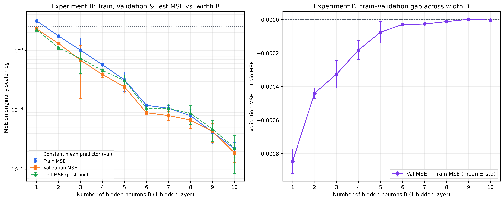
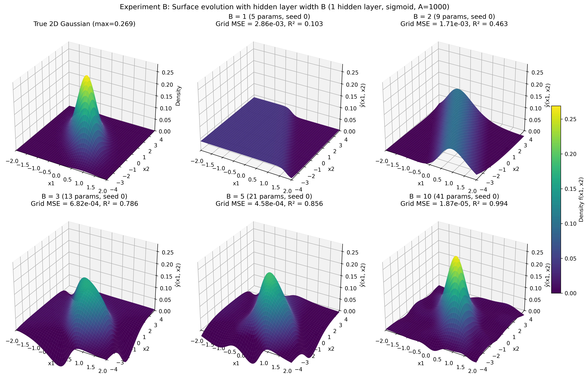

# Mục 4.3 – Thực nghiệm B: ảnh hưởng của số nơ-ron tầng ẩn

> Bản thảo TV3. Tổng hợp từ 30 run chính ($B \in \{1, 2, \dots, 10\} \times 3\text{ seed}$) và đối chiếu với 9 run mở rộng một tầng ẩn ($B \in \{38, 65, 93\} \times 3\text{ seed}$). Mọi metric dưới đây được tính trên thang $y$ gốc; độ lệch chuẩn (std) là độ lệch chuẩn mẫu giữa ba seed. Nguồn dữ liệu: `results/expB/summary.csv`, `results/expB/aggregate.csv`, sinh bằng lệnh `python src/summarize_expB.py`.

## Thiết kế

Thực nghiệm B khảo sát tác động của độ rộng tầng ẩn $B \in \{1, 2, 3, 4, 5, 6, 7, 8, 9, 10\}$ đối với mạng MLP có **một tầng ẩn duy nhất** ($C = 1$, kiến trúc $2 \rightarrow [B] \rightarrow 1$). Số tham số huấn luyện tăng tuyến tính theo công thức $N_{\text{params}} = (2 \times B + B) + (B \times 1 + 1) = 4B + 1$, từ $5$ tham số ($B = 1$) đến $41$ tham số ($B = 10$).

Các điều kiện khác được giữ cố định theo đúng cấu hình baseline đã chốt ở Giai đoạn 2:
- Kích thước tập huấn luyện: $A = 1000$ mẫu đầu của `train_pool.csv`; tập validation cố định $200$ mẫu (`val.csv`).
- Hàm kích hoạt tầng ẩn: `sigmoid`; tầng đầu ra tuyến tính.
- Bộ tối ưu: Adam với learning rate $0.01$, batch size $32$, tối đa $2000$ epoch, dừng sớm (early stopping) theo validation MSE với `patience = 200`.
- Ba seed khởi tạo và xáo batch độc lập: `seed = 0, 1, 2`.
- Để kiểm tra xu hướng khi độ rộng tăng lớn hơn nữa trên cùng kiến trúc 1 tầng ẩn, nhóm đối chiếu thêm với ba mức độ rộng mở rộng $B \in \{38, 65, 93\}$ ($153, 261, 373$ tham số) từ `results/expC_ctrl/`. Tập `test.csv` hoàn toàn không được sử dụng trong quá trình chạy và phân tích Thực nghiệm B.

## Kết quả

Mô hình tầm thường dự đoán hằng số bằng trung bình nhãn tập train ($\bar{y}_{\text{train}} \approx 0.0315$) có validation MSE bằng $2.49 \times 10^{-3}$.

**Bảng 4.3.1.** Kết quả Thực nghiệm B ($B = 1 \dots 10$) và các cấu hình 1 tầng ẩn mở rộng ($B = 38, 65, 93$) tại checkpoint tốt nhất theo validation (mean ± std qua 3 seed, thang $y$ gốc; cột Test MSE được tính hậu kiểm trên trọng số `best.pt` đã đóng băng).

| Độ rộng $B$ | Tham số ($4B+1$) | Train MSE | Validation MSE | Test MSE *(hậu kiểm)* | Validation MAE | Validation RMSE | Khoảng cách Val − Train MSE | Epoch tốt nhất |
|---:|---:|---:|---:|---:|---:|---:|---:|---:|
| 1 | 5 | 3.14e-3 ± 2.24e-4 | 2.29e-3 ± 1.51e-4 | 2.23e-3 ± 1.13e-4 | 3.24e-2 ± 2.23e-3 | 4.78e-2 ± 1.57e-3 | −8.46e-4 ± 7.31e-5 | 515 ± 353 |
| 2 | 9 | 1.75e-3 ± 3.23e-5 | 1.31e-3 ± 1.82e-5 | 1.11e-3 ± 1.19e-5 | 2.20e-2 ± 3.86e-4 | 3.61e-2 ± 2.53e-4 | −4.39e-4 ± 3.03e-5 | 69 ± 52 |
| 3 | 13 | 1.01e-3 ± 6.10e-4 | 6.84e-4 ± 5.28e-4 | 7.28e-4 ± 3.21e-4 | 1.58e-2 ± 5.17e-3 | 2.50e-2 ± 9.52e-3 | −3.25e-4 ± 8.25e-5 | 334 ± 244 |
| 4 | 17 | 5.73e-4 ± 2.94e-5 | 3.91e-4 ± 4.54e-5 | 4.57e-4 ± 1.94e-5 | 1.38e-2 ± 6.40e-4 | 1.98e-2 ± 1.15e-3 | −1.82e-4 ± 5.57e-5 | 637 ± 583 |
| 5 | 21 | 3.18e-4 ± 1.15e-4 | 2.43e-4 ± 5.20e-5 | 3.12e-4 ± 7.25e-5 | 1.09e-2 ± 1.44e-3 | 1.55e-2 ± 1.63e-3 | −7.53e-5 ± 6.41e-5 | 487 ± 189 |
| 6 | 25 | 1.19e-4 ± 3.49e-7 | 8.91e-5 ± 2.24e-6 | 1.07e-4 ± 1.84e-5 | 6.88e-3 ± 3.10e-4 | 9.44e-3 ± 1.18e-4 | −2.99e-5 ± 1.98e-6 | 1046 ± 461 |
| 7 | 29 | 1.06e-4 ± 1.11e-5 | 7.98e-5 ± 1.40e-5 | 1.06e-4 ± 1.78e-5 | 6.56e-3 ± 7.71e-4 | 8.91e-3 ± 8.05e-4 | −2.63e-5 ± 3.18e-6 | 1069 ± 854 |
| 8 | 33 | 7.95e-5 ± 2.28e-5 | 6.73e-5 ± 1.94e-5 | 8.74e-5 ± 3.04e-5 | 6.13e-3 ± 7.79e-4 | 8.14e-3 ± 1.24e-3 | −1.22e-5 ± 3.47e-6 | 913 ± 594 |
| 9 | 37 | 4.21e-5 ± 1.54e-5 | 4.34e-5 ± 1.53e-5 | 4.76e-5 ± 1.79e-5 | 4.98e-3 ± 8.21e-4 | 6.52e-3 ± 1.12e-3 | +1.31e-6 ± 1.26e-6 | 1618 ± 224 |
| 10 | 41 | 2.21e-5 ± 6.15e-6 | 1.89e-5 ± 5.89e-6 | 2.28e-5 ± 1.43e-5 | 3.35e-3 ± 5.64e-4 | 4.31e-3 ± 6.83e-4 | −3.21e-6 ± 1.54e-6 | 1653 ± 411 |
| 38 *(mở rộng)* | 153 | 2.38e-6 ± 1.10e-6 | 2.42e-6 ± 1.56e-6 | 2.96e-6 ± 1.78e-6 | 1.18e-3 ± 3.75e-4 | 1.50e-3 ± 4.84e-4 | +3.69e-8 ± 5.01e-7 | 1378 ± 582 |
| 65 *(mở rộng)* | 261 | 1.87e-6 ± 9.53e-7 | 1.68e-6 ± 8.72e-7 | 1.93e-6 ± 1.23e-6 | 9.95e-4 ± 2.56e-4 | 1.26e-3 ± 3.50e-4 | −1.90e-7 ± 9.61e-8 | 1084 ± 221 |
| 93 *(mở rộng)* | 373 | 1.11e-6 ± 1.58e-7 | 1.46e-6 ± 4.32e-7 | 1.41e-6 ± 2.01e-7 | 9.06e-4 ± 9.79e-5 | 1.20e-3 ± 1.88e-4 | +3.50e-7 ± 3.25e-7 | 1266 ± 445 |

## Hình minh họa và Phân tích

**Hình 4.3.1.** Trái: Train MSE và Validation MSE (thang log) theo số nơ-ron ẩn $B = 1 \dots 10$ kèm đường baseline dự đoán trung bình. Phải: Khoảng cách $\text{Validation MSE} - \text{Train MSE}$ theo $B$.

**Hình 4.3.2.** Bề mặt hàm Gaussian 2D thật và bề mặt xấp xỉ của mạng MLP 1 tầng ẩn tại $B \in \{1, 2, 3, 5, 10\}$ (`seed = 0`, cùng giới hạn trục $z \in [0, 0.28]$).

### 1. Hiện tượng thiếu khớp (Underfitting) khi $B$ nhỏ và giải thích hình học

- **Giảm đơn điệu trên toàn dải $B = 1 \dots 10$:** Khi tăng $B$ từ $1$ lên $10$, cả Train MSE và Validation MSE đều giảm liên tục hơn **120 lần** (Validation MSE giảm từ $2.29 \times 10^{-3}$ tại $B=1$ xuống $1.89 \times 10^{-5}$ tại $B=10$; Validation RMSE giảm hơn 11 lần từ $4.78 \times 10^{-2}$ xuống $4.31 \times 10^{-3}$).
- **Cơ chế hình học tại $B = 1, 2, 3$ (Hình 4.3.2):**
  - Với **$B = 1$**: Đầu ra của mạng có dạng $\hat{y}(x_1, x_2) = w_1 \sigma(u_{11}x_1 + u_{12}x_2 + b_1) + c$. Đây là một **hàm sống núi đơn điệu (ridge function)** chỉ biến thiên dọc theo một hướng pháp tuyến duy nhất $(u_{11}, u_{12})$ và hằng số trên các đường thẳng vuông góc với hướng đó. Về mặt toán học, một hàm đơn điệu không thể tạo ra cực đại cục bộ khép kín. Kết quả là bề mặt $B=1$ gần như một mặt phẳng nghiêng có một bậc thang ở góc miền, đạt $\text{Grid MSE} = 2.86 \times 10^{-3}$ ($R^2 = 0.103$), chỉ nhỉnh hơn không đáng kể so với dự đoán hằng số ($2.49 \times 10^{-3}$).
  - Với **$B = 2$**: Hai hàm sigmoid ngược chiều ghép lại tạo thành một "dải sống núi" chạy xuyên qua miền dọc theo trục chính của elip Gaussian ($\text{Grid MSE} = 1.71 \times 10^{-3}, R^2 = 0.463$). Mạng đã chặn được hai bên sườn ngang nhưng vẫn không thể khép kín hai đầu dọc theo trục dài, nên dừng sớm ở khoảng epoch $69 \pm 52$.
  - Với **$B = 3$**: Ba mặt phẳng cắt nhau mới bắt đầu bao quanh gốc tọa độ để tạo ra một đỉnh nhọn hình tam giác ($\text{Grid MSE} = 6.82 \times 10^{-4}, R^2 = 0.786$). Tuy nhiên tại $B = 3$, `seed = 2` bị kẹt ở cực trị cục bộ tương đương cấu hình $B = 2$ ($\text{Val MSE} = 1.29 \times 10^{-3}$ so với $3.77 \times 10^{-4}$ của `seed = 0`), làm thanh sai số (error bar) tại $B = 3$ rộng hơn hẳn các điểm lân cận.
  - Từ **$B = 5$ đến $B = 10$**: Khi có từ $5$ đến $10$ "sườn dốc" sigmoid xoay theo nhiều góc khác nhau quanh gốc tọa độ, mạng khép kín được hình nón elip nghiêng của hàm mật độ Gaussian ($\text{Grid } R^2$ tăng từ $0.856$ tại $B=5$ lên $0.994$ tại $B=10$).

### 2. Phân tích khoảng cách Train – Validation và hiện tượng quá khớp (Overfitting)

- **Không xuất hiện quá khớp (overfitting) khi tăng $B$:** Trên Hình 4.3.1 (phải), hiệu số $\text{Validation MSE} - \text{Train MSE}$ âm nhẹ ở vùng underfitting ($B = 1 \dots 8$) và tiến sát về $0$ tại $B = 9, 10$ (lần lượt $+1.31 \times 10^{-6}$ và $-3.21 \times 10^{-6}$). Ngay cả khi mở rộng lên $B = 38, 65, 93$ ($373$ tham số), Validation MSE vẫn tiếp tục giảm xuống $1.46 \times 10^{-6} \pm 4.32 \times 10^{-7}$ mà không hề tăng ngược trở lại.
- **Vì sao ở $B$ nhỏ, Validation MSE lại thấp hơn Train MSE?** Tập `val.csv` ($200$ mẫu) có phương sai mẫu của nhãn $y$ nhỏ hơn nhẹ so với $1000$ mẫu tập train (do tỷ lệ điểm rơi vào vùng đuôi $y \approx 0$ nhỉnh hơn một chút). Khi mô hình bị underfit nặng ($B \le 5$) và dự đoán thiên về giá trị nền thấp, sai số trung bình trên tập validation tự nhiên nhỏ hơn trên tập train. Khi mô hình khớp sát hàm thật ($B \ge 9$), chênh lệch này biến mất.
- **Lý giải sự khác biệt so với đường cong chữ U cổ điển:**
  1. **Nhãn hoàn toàn không có nhiễu ($\epsilon = 0$):** Dữ liệu được sinh trực tiếp từ công thức giải tích $y = f(x_1, x_2)$. Theo lý thuyết học thống kê, quá khớp nặng xảy ra khi mạng dư dung lượng dùng các bậc tự do thừa để ghi nhớ nhiễu ngẫu nhiên tại các điểm train. Khi không có nhiễu và số mẫu $A = 1000$ phủ đủ dày mặt phẳng 2D (lớn hơn nhiều so với $41$ tham số ở $B = 10$), việc tăng độ rộng chỉ giúp giảm sai số xấp xỉ (bias) theo Định lý Xấp xỉ Phổ quát (Cybenko, 1989) mà không làm bùng nổ phương sai (variance).
  2. **Cơ chế dừng sớm (early stopping) theo validation:** Việc lưu checkpoint `best.pt` tại epoch có validation loss thấp nhất giúp ngăn chặn mô hình tiếp tục cập nhật khi validation loss bắt đầu dao động.
- **So sánh với tăng độ sâu (Thực nghiệm C):** Dù mở rộng tới $B = 93$ ($373$ tham số), mạng 1 tầng ẩn chỉ đạt Validation MSE $1.46 \times 10^{-6}$, vẫn cao hơn khoảng **24 lần** so với mạng 3 tầng ẩn `[10, 10, 10]` ($261$ tham số, Validation MSE $6.02 \times 10^{-8}$). Điều này khẳng định với hàm có đỉnh cục bộ như Gaussian 2D, ghép nhiều tầng phi tuyến hiệu quả về mặt tham số hơn rất nhiều so với chỉ mở rộng một tầng ẩn.

