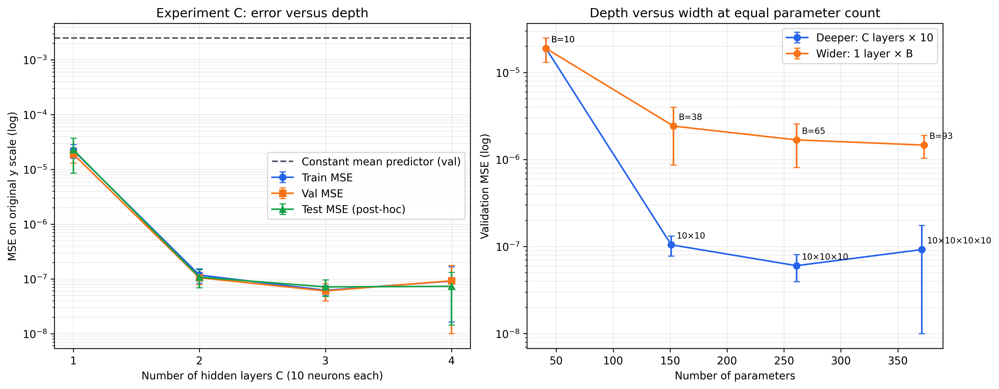
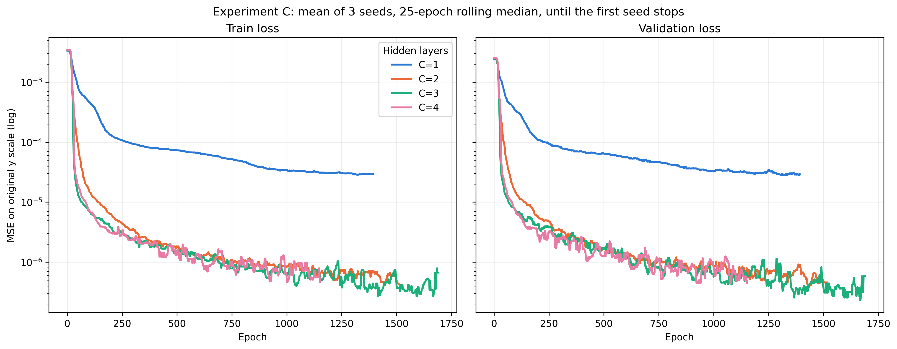
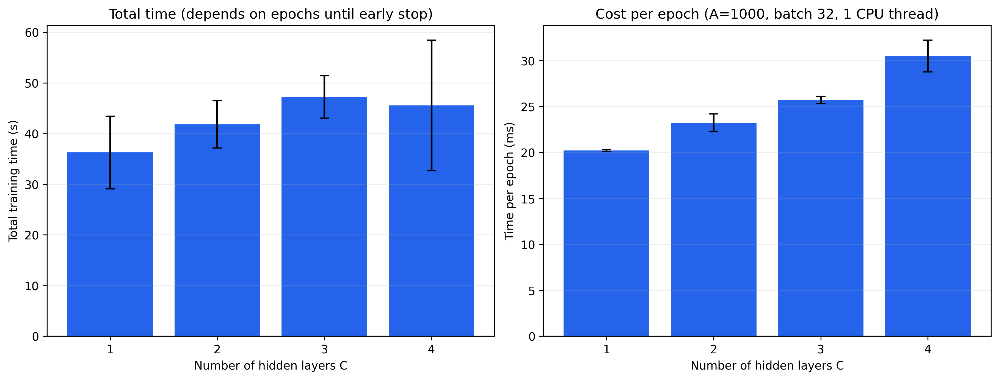
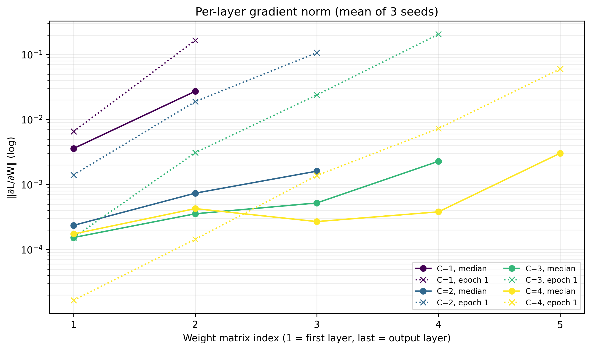

# Mục 4.4 – Thực nghiệm C: ảnh hưởng của số tầng ẩn

> Bản thảo TV2. Tổng hợp từ 12 run C (4 độ sâu × 3 seed) và 9 run đối chứng (3 độ rộng × 3 seed). Mọi metric ở thang y gốc; std là độ lệch chuẩn mẫu giữa ba seed. Nguồn: **results/expC/aggregate.csv**, **results/expC/grad_norms.csv**, sinh bằng **python src/summarize_expC.py**.

## Thiết kế

Thay đổi số tầng ẩn C ∈ {1, 2, 3, 4}, mỗi tầng 10 nơ-ron. Các yếu tố khác giữ đúng baseline: A = 1000, sigmoid, Adam lr 0.01, batch 32, tối đa 2.000 epoch, early stopping patience 200, seed 0, 1, 2. C = 1 chính là baseline, tức cùng cấu hình với run A = 1000 của Thực nghiệm A. Hai nhóm run này chạy trên hai máy khác nhau nên số không trùng từng chữ số: validation MSE cùng seed chênh tương đối dưới 0.01%, không ảnh hưởng đến các chữ số báo cáo trong bảng.

Tăng C cũng tăng số tham số (41 → 151 → 261 → 371). Để tách "sâu hơn" khỏi "nhiều tham số hơn", chạy thêm **nhóm đối chứng**: mạng **một** tầng ẩn với B = 38, 65, 93 nơ-ron, có 153, 261, 373 tham số (\(4B+1\)), gần bằng C = 2, 3, 4.

Thời gian đo bằng **time.perf_counter()** chỉ quanh **fit()**, cùng máy, 1 luồng CPU, các run chạy tuần tự (không chạy song song). Mỗi epoch ghi chuẩn gradient \(\lVert\partial L/\partial W^{(l)}\rVert\) của từng lớp để kiểm tra vanishing gradient bằng số liệu.

## Kết quả

Baseline dự đoán hằng số (trung bình nhãn train) có validation MSE 2.49e-3.

**Bảng 4.4.1.** Thực nghiệm C và nhóm đối chứng cùng số tham số (mean ± std, 3 seed), đo tại checkpoint tốt nhất theo validation.

| Mạng | Tham số | Train MSE | Validation MSE | Validation MAE | Validation RMSE | Epoch tốt nhất | Thời gian (s) | ms/epoch |
|---|---:|---:|---:|---:|---:|---:|---:|---:|
| C=1 [10] | 41 | 2.21e-5 ± 6.15e-6 | 1.89e-5 ± 5.89e-6 | 3.35e-3 ± 5.64e-4 | 4.31e-3 ± 6.83e-4 | 1653 ± 411 | 36.3 ± 7.2 | 20.2 ± 0.1 |
| C=2 [10,10] | 151 | 1.17e-7 ± 3.45e-8 | 1.05e-7 ± 2.70e-8 | 2.35e-4 ± 2.99e-5 | 3.22e-4 ± 4.36e-5 | 1653 ± 315 | 41.8 ± 4.7 | 23.2 ± 1.0 |
| C=3 [10,10,10] | 261 | 6.18e-8 ± 1.25e-8 | 6.02e-8 ± 2.07e-8 | 1.80e-4 ± 2.56e-5 | 2.43e-4 ± 4.20e-5 | 1667 ± 208 | 47.2 ± 4.2 | 25.7 ± 0.4 |
| C=4 [10,10,10,10] | 371 | 9.09e-8 ± 7.47e-8 | 9.21e-8 ± 8.22e-8 | 2.25e-4 ± 1.11e-4 | 2.85e-4 ± 1.29e-4 | 1298 ± 442 | 45.5 ± 12.9 | 30.5 ± 1.7 |
| Đối chứng [38] | 153 | 2.38e-6 ± 1.10e-6 | 2.42e-6 ± 1.56e-6 | 1.18e-3 ± 3.75e-4 | 1.50e-3 ± 4.84e-4 | 1378 ± 582 | 32.3 ± 13.2 | 20.9 ± 1.9 |
| Đối chứng [65] | 261 | 1.87e-6 ± 9.53e-7 | 1.68e-6 ± 8.72e-7 | 9.95e-4 ± 2.56e-4 | 1.26e-3 ± 3.50e-4 | 1084 ± 221 | 26.0 ± 5.2 | 20.2 ± 0.6 |
| Đối chứng [93] | 373 | 1.11e-6 ± 1.58e-7 | 1.46e-6 ± 4.32e-7 | 9.06e-4 ± 9.79e-5 | 1.20e-3 ± 1.88e-4 | 1266 ± 445 | 29.6 ± 9.1 | 20.2 ± 0.1 |

**Hình 4.4.1.** Trái: train và validation MSE theo số tầng ẩn C, có error bar ± std. Phải: validation MSE của mạng sâu và mạng một tầng rộng theo số tham số.

**Hình 4.4.2.** Train loss và validation loss theo epoch với C = 1…4: trung bình 3 seed, làm mượt bằng trung vị trượt 25 epoch, vẽ đến epoch mà seed đầu tiên dừng. Đường đã làm mượt nên nằm cao hơn MSE tại checkpoint tốt nhất trong Bảng 4.4.1.

**Hình 4.4.3.** Tổng thời gian huấn luyện (trái) và thời gian mỗi epoch (phải) theo số tầng ẩn C, có error bar ± std.

**Hình 4.4.4.** Chuẩn gradient của từng lớp ở epoch đầu và trung vị qua các epoch (trung bình 3 seed).

## Nhận xét

**Thêm tầng làm lỗi giảm mạnh, nhưng chỉ đến C = 2–3.** Validation MSE giảm khoảng 180 lần từ C = 1 (1.89e-5) sang C = 2 (1.05e-7) (Bảng 4.4.1, Hình 4.4.1). Từ C = 2 đến C = 4 lỗi nằm cùng bậc 1e-7; khoảng ± std của C = 3 và C = 4 chồng nhau, nên không kết luận được C = 3 tốt hơn C = 4. Train và validation MSE gần bằng nhau ở mọi C: không thấy quá khớp, phù hợp với dữ liệu không nhiễu. Đường hội tụ cũng cho thấy điều này (Hình 4.4.2): với C ≥ 2, loss xuống dưới 1e-5 trong khoảng 200 epoch đầu rồi ba đường gần như chồng nhau, còn C = 1 chỉ giảm chậm về quanh 3e-5.

**Lợi ích đến từ độ sâu, không chỉ từ số tham số.** Ở cùng số tham số, mạng sâu có validation MSE thấp hơn mạng một tầng rộng 16–28 lần (Hình 4.4.1 phải; 151 so với 153 tham số: 1.05e-7 so với 2.42e-6; 261: 6.02e-8 so với 1.68e-6; 371/373: 9.21e-8 so với 1.46e-6). Mạng rộng cải thiện khi B tăng từ 10 lên 38 rồi gần như chững ở khoảng 1.5e-6. Cách giải thích: mỗi nơ-ron sigmoid ở tầng một chỉ tạo một "sườn dốc" theo một hướng; muốn ghép thành một đỉnh cục bộ hình elip cần rất nhiều sườn. Tầng thứ hai kết hợp các sườn này thành vùng lồi bao quanh đỉnh, nên biểu diễn được hình dạng đó bằng ít tham số hơn (DL07b p52, p54).

**Có vanishing gradient lúc khởi tạo, nhưng không cản trở việc huấn luyện.** Ở epoch đầu, chuẩn gradient giảm đều khoảng 5–10 lần sau mỗi tầng khi lan ngược (Hình 4.4.4): với C = 4, lớp đầu chỉ 1.7e-5 so với 6.0e-2 ở lớp ra (chênh khoảng 3.600 lần); với C = 1 chênh khoảng 25 lần. Mức giảm phù hợp với \(\sigma'(z)\le0.25\) nhân dồn qua các tầng (mục 3.2). Chênh lệch này lớn hơn nhiều so với ảnh hưởng của kích thước ma trận (W⁽¹⁾ có 20 phần tử, các tầng giữa 100), nên không phải do cách đo. Trong quá trình huấn luyện, trung vị chuẩn gradient của các tầng ẩn chỉ còn chênh trong khoảng 2.5 lần (C = 4: 1.7e-4 đến 4.3e-4), và mạng sâu vẫn đạt lỗi thấp nhất. Một lý do hợp lý là Adam chia bước cập nhật cho \(\sqrt{\hat v_t}\), nên tham số có gradient nhỏ vẫn được cập nhật với bước cỡ lr. Nhóm chưa chạy SGD thuần nên chưa kiểm chứng được giả thuyết này; với SGD, vanishing gradient có thể ảnh hưởng rõ hơn.

**Chi phí mỗi epoch tăng theo số tầng, không theo số tham số.** Thời gian mỗi epoch tăng từ 20.2 ms (C = 1) lên 30.5 ms (C = 4), khoảng +3.4 ms mỗi tầng (Hình 4.4.3). Mạng một tầng 93 nơ-ron (373 tham số) vẫn chỉ 20.2 ms/epoch, bằng mạng 41 tham số. Với mạng nhỏ thế này, thời gian bị chi phối bởi số phép tính tuần tự (mỗi tầng một lượt nhân ma trận, hàm kích hoạt và lan truyền ngược) chứ không bởi kích thước ma trận. Tổng thời gian (36–47 s) dao động nhiều hơn vì phụ thuộc số epoch đến khi early stopping dừng.

**Kết quả ngược với Sample_Report.** Báo cáo mẫu cho rằng tăng tầng làm lỗi tăng do vanishing gradient. Số liệu của nhóm cho thấy điều ngược lại trong điều kiện này (Adam, tối đa 4 tầng, 10 nơ-ron/tầng). Nhóm có đo được vanishing gradient, nhưng nó không làm hỏng việc huấn luyện.

## Hạn chế

- **Validation MSE của mạng sâu hơi lạc quan.** Đường validation loss gốc của C ≥ 2 dao động mạnh, từ khoảng 1e-7 đến 1e-5 giữa các epoch liền nhau; Hình 4.4.2 đã làm mượt nên không thể hiện hết dao động này. Lý do có thể là lr 0.01 quá lớn để tinh chỉnh khi lỗi đã rất nhỏ. Checkpoint được chọn đúng ở epoch có val loss thấp nhất, nên val MSE báo cáo nghiêng về phía tốt. Train MSE tại cùng checkpoint cũng ở bậc 1e-7, cho thấy checkpoint không chỉ tốt riêng trên val; dù vậy, đánh giá khách quan cần dùng tập test ở bước cuối.
- Một số run vẫn cải thiện gần epoch 2.000 (ví dụ C = 2 seed 2: epoch tốt nhất 1941/2000), nên lỗi có thể còn giảm nếu cho chạy lâu hơn.
- Chỉ xét sigmoid, Adam, lr 0.01 và tối đa 4 tầng; kết luận có thể đổi với activation, optimizer hoặc lr khác, và với mạng sâu hơn (5, 6, 8 tầng chưa chạy).
- Không đánh giá test trong Thực nghiệm C, nhất quán với Thực nghiệm A; test dành cho mô hình cuối do nhóm chọn bằng validation.
