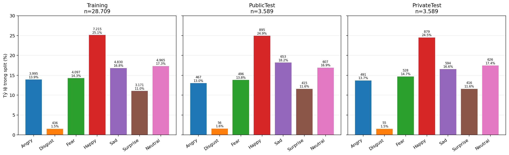
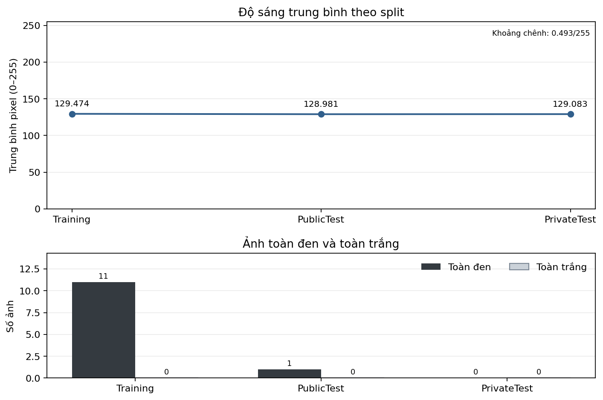
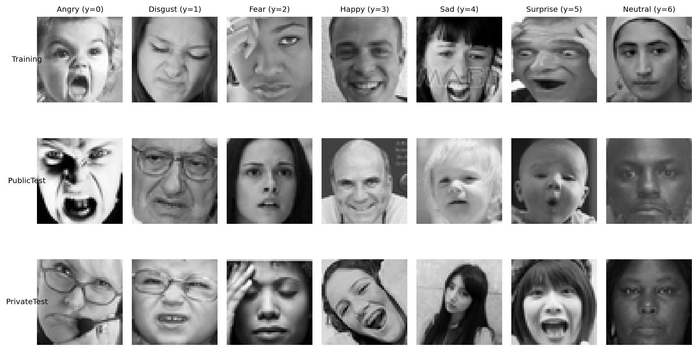
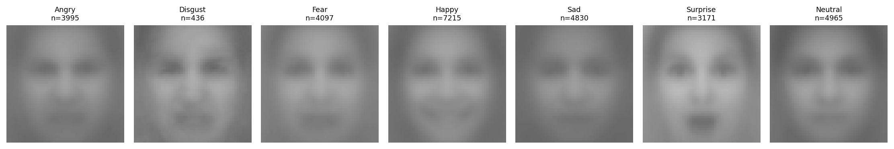

# Chương 2. Dữ liệu FER2013

> **Xác nhận review chéo Chương 2–4 (`C1` — TV2 – Lê Phan Nguyên Hải, 2026-11-28):** Đã dò từng số, bảng và hình của Chương 2 (gồm E4, E5 ở mục 2.6–2.7 trong bản Word), Chương 3 và Chương 4 về nguồn sinh từ code: `results/data_check.json`, `figures/eda_{class_distribution,image_quality,samples}.csv`, `report/tables/{baseline,E1..E7}_summary.csv`, `E7_tta_ensemble.csv`, `E6_analysis.md`, `figures/{e2_grad_norms,e4_overfit_summary,e7_test_confusion,e7_test_error_hist,e7_test_wrong_grid,arch_cnn_baseline,arch_cnn_comparison}.csv`, `results/E5/E5-00{1,2,3}_s0/per_class_recall.csv`, `results/{E1,E2,E3}/*/history.csv`, `results/E2/*/grad_norms.csv`, `results/baseline/baseline_summary.json`, `results/E7/{e7_val_summary.json,TEST_DONE.json,test_per_class.csv,e7_gradcam_cases.csv}`, `tracking/experiments.csv`, `tracking/test_log.csv` và `configs/*.json`. Kết quả: mọi bảng (Bảng 2.1–2.6, 3.1–3.10, 4.1–4.5 và bảng cặp nhầm lẫn) khớp nguồn; số trong lời văn (ba seed `large_bn`, chuỗi gradient E2, số lần giảm lr và epoch dừng của sigmoid, số đo VGG16/ResNet18, Bước 1 E7, từng seed trên PublicTest và PrivateTest, 14 ô ma trận nhầm lẫn, cụm `665/946` và `640/946`, 9 ca sai, 30 ca Grad-CAM) khớp nguồn; tính lại accuracy và macro-F1 E5 từ `per_class_recall.csv` trùng `metrics.json`; 20/20 hình được nhắc có file và SHA-256 khớp `tracking/figures_manifest.csv`; số trong `BaoCao_BTL02.docx` trùng các file `.md`. Đã góp ý 5 chỗ diễn đạt lệch nguồn (độ tự tin ca sai `0.63–0.97`, tanh kém ReLU `3.9–4.5` điểm, train_loss `1.83` ở epoch 1, câu thừa ở chú thích Hình 2.5, `16.55×`); TV4 đã sửa ở `2df2ce7` và dựng lại `.docx`/`.pdf`, đã kiểm lại cả hai bản. Đạt yêu cầu phối hợp `C1` của `T25`.

## 2.1. Bộ dữ liệu và kiểm tra toàn vẹn

Đồ án dùng bản FER2013 dạng CSV với ba trường `emotion`, `pixels`, `Usage`. Mỗi ảnh là ảnh xám 48 × 48 pixel, giá trị pixel nằm trong khoảng 0–255; nhãn nguyên 0–6 được ánh xạ lần lượt sang Angry, Disgust, Fear, Happy, Sad, Surprise và Neutral. Bộ đọc dữ liệu của dự án kiểm tra số pixel mỗi dòng và ánh xạ `Training` → train, `PublicTest` → validation, `PrivateTest` → test.

`results/data_check.json` ghi kết quả kiểm tra **PASS** cho 35.887 dòng, đúng ba split dự kiến, không có Usage hoặc cột bất thường. Bản dữ liệu được kiểm tra ngày 24/11/2026 có SHA-256 `3b8d9617d1017f34733c8f2474d7784c563ce86c40a86ac12c2d37cc968f871b`. CSV gốc được giữ ở máy chạy, không đưa vào Git; checksum giúp xác nhận các run dùng cùng một bản dữ liệu.

| Split | Số ảnh | Vai trò trong thí nghiệm |
|---|---:|---|
| Training | 28.709 | Huấn luyện và ước lượng thống kê chuẩn hóa |
| PublicTest | 3.589 | Validation, chọn cấu hình và so sánh run |
| PrivateTest | 3.589 | Chỉ dành cho đánh giá mô hình cuối theo quy tắc T19 |
| **Tổng** | **35.887** | |

Nguồn: `results/data_check.json`; script kiểm tra: `src/data/check_fer2013.py`.

## 2.2. Phân bố nhãn

Training mất cân bằng rõ rệt: Happy có 7.215 ảnh (25,13%), trong khi Disgust có 436 ảnh (1,52%), chênh khoảng 16,55 lần. Bảng dưới đây được trích từ CSV EDA, không ước lượng từ biểu đồ.

| Nhãn | Số ảnh Training | Tỷ lệ Training |
|---|---:|---:|
| Angry | 3.995 | 13,92% |
| Disgust | 436 | 1,52% |
| Fear | 4.097 | 14,27% |
| Happy | 7.215 | 25,13% |
| Sad | 4.830 | 16,82% |
| Surprise | 3.171 | 11,05% |
| Neutral | 4.965 | 17,29% |

`figures/eda_class_distribution.csv` cũng lưu số lượng và tỷ lệ theo từng lớp cho cả ba split. Tỷ lệ Disgust thấp tương tự trên PublicTest (56/3.589; 1,56%) và PrivateTest (55/3.589; 1,53%). Hình 2.1 thể hiện phân bố riêng từng split để quy mô Training không che khuất hai tập còn lại.

**Hình 2.1.** Phân bố nhãn theo split. Nguồn hình và số liệu: `figures/eda_class_distribution.png` và `.csv`, sinh bởi `src/data/eda.py`.

## 2.3. Đặc điểm ảnh và chất lượng dữ liệu

Độ sáng trung bình nằm gần 129/255 ở cả ba split. Bộ kiểm tra EDA tìm thấy 11 ảnh toàn đen trong Training, một ảnh trong PublicTest, không có ảnh toàn trắng; số ảnh gần đen theo ngưỡng của script trùng số ảnh toàn đen. Các con số trong Bảng 2.2 lấy trực tiếp từ `figures/eda_image_quality.csv`.

| Split | Số ảnh | Độ sáng trung bình (0–255) | Ảnh toàn đen | Ảnh toàn trắng |
|---|---:|---:|---:|---:|
| Training | 28.709 | 129,474 | 11 | 0 |
| PublicTest | 3.589 | 128,981 | 1 | 0 |
| PrivateTest | 3.589 | 129,083 | 0 | 0 |

**Hình 2.2.** Kiểm tra độ sáng và ảnh bất thường. “Gần đen” được định nghĩa trong script là ít nhất 99% pixel có giá trị ≤ 2; “gần trắng” là ít nhất 99% pixel ≥ 253. Hình và CSV nguồn được sinh bởi `src/data/eda.py`.

Hình 2.3 là lưới mẫu được lấy cố định theo seed 0, mỗi lớp một ảnh trong mỗi split. Hình 2.4 là ảnh trung bình theo lớp, chỉ tính trên Training.

**Hình 2.3.** Ảnh mẫu FER2013; chỉ số mẫu và pixel được lưu trong `figures/eda_samples.csv`.

**Hình 2.4.** Ảnh trung bình theo lớp, tính riêng trên Training từ `figures/eda_mean_images.csv`.

## 2.4. Tiền xử lý và chống rò rỉ dữ liệu

`src/data/fer2013.py` đọc ảnh thành mảng `uint8` kích thước `(N, 48, 48)` và giữ nguyên thứ tự nhãn của FER2013. `src/data/loader.py` chuyển pixel sang số thực trong [0, 1]; mean và độ lệch chuẩn được tính chỉ từ Training rồi dùng để chuẩn hóa các split. Với cấu hình cần ảnh lớn hơn hoặc ba kênh, thay đổi kích thước và lặp kênh được thực hiện theo cấu hình model. Augmentation chỉ gắn vào loader huấn luyện.

PrivateTest không được đưa vào fit chuẩn hóa, huấn luyện, chọn cấu hình hay các thí nghiệm E4/E5. Các thống kê ở Chương 2 chỉ mô tả cấu trúc và chất lượng của file dữ liệu; việc đánh giá dự đoán trên PrivateTest được giữ riêng cho lượt cuối theo T19.

## 2.5. Giới hạn dữ liệu

Ảnh 48 × 48 có độ phân giải thấp và phân bố lớp lệch; hai điểm này có thể làm khó phân biệt các biểu cảm tương tự và làm giảm khả năng học lớp hiếm. CSV không có metadata về danh tính, tuổi, giới tính hoặc điều kiện chụp, nên **chưa thực hiện** phân tích các yếu tố đó. Các hình EDA là mô tả tập dữ liệu, không phải phép đo công bằng theo nhóm người.

## Nguồn và lệnh tái lập

- Kiểm tra schema, số split và SHA-256: `python -X utf8 -m src.data.check_fer2013 --csv data/fer2013.csv --output results/data_check.json --download-date 2026-11-24`.
- Sinh năm hình EDA và các CSV dữ liệu: `python -X utf8 -m src.data.eda --csv data/fer2013.csv --output-dir figures --seed 0`.
- Bảng nguồn: `results/data_check.json`, `figures/eda_class_distribution.csv`, `figures/eda_image_quality.csv`, `figures/eda_samples.csv`, `figures/eda_mean_images.csv`.
- Mã xử lý: `src/data/check_fer2013.py`, `src/data/fer2013.py`, `src/data/loader.py`, `src/data/eda.py`.
