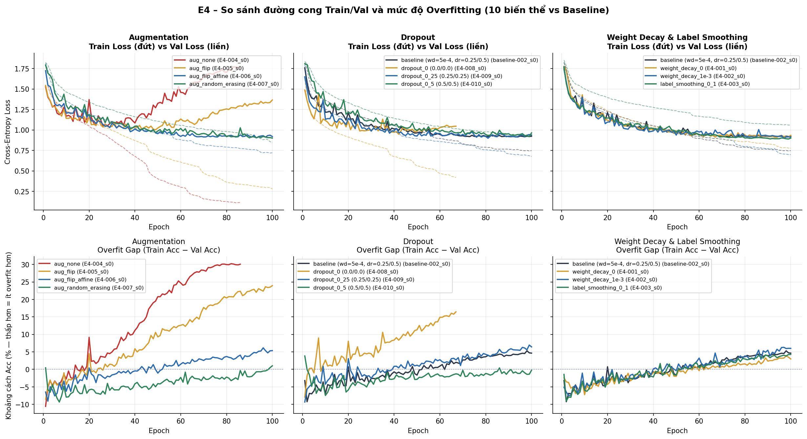
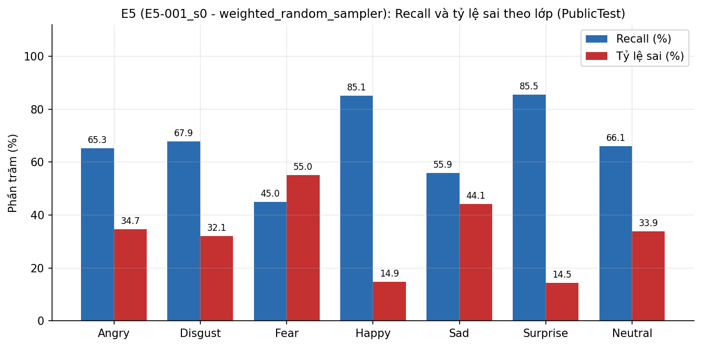

# Bổ sung Chương 4. Thực nghiệm E4 và E5

> Bản nội dung T21 để ghép cùng Chương 4. Bảng và hình được giữ tên theo nhóm thí nghiệm; số thứ tự cuối cùng sẽ được chuẩn hóa khi ghép toàn bộ báo cáo.
>
> **Xác nhận review chéo mục E4, E5 (`C2` — TV3 – Võ Hoàng Bảo, 2026-11-27):** Đã đối chiếu độc lập 100% số liệu, bảng và hình trong tài liệu với nguồn sinh từ code (`report/tables/{baseline,E4,E5}_summary.csv`, `tracking/experiments.csv`, `tracking/figures_manifest.csv`, `figures/e4_overfit_summary.csv`, `figures/e5_wrs_recall.csv`, `results/E5/E5-001_s0/per_class_recall.csv`, `configs/E4_aug_reg.json` và `configs/E5_imbalance.json`): (1) **Bảng E4-1 & nhận xét E4**: khớp 100% cả 10/10 biến thể (`val_acc`, `val_macro_f1`, `best_val_loss` khớp `E4_summary.csv`; cột `Train–Val tại best epoch` khớp `acc_gap_at_best × 100` của `e4_overfit_summary.csv`, kể cả mốc `baseline-002_s0 = 4,72` điểm % và cặp tham số dropout trong `E4_aug_reg.json`); (2) **Bảng E5-1, E5-2 & kết luận E5**: khớp 100% cả 3/3 biến thể (`E5-003_s0` `0,6815 / F1 0,6416`, `E5-002_s0` `0,6612 / −2,03 điểm %`, `E5-001_s0` `0,6824 / +0,08 điểm % / F1 0,6717 / +3,01 điểm %`) và recall `E5-001_s0` (`Disgust 67,86% = 38/56`, `Fear 44,96% = 223/496`); (3) **Minh bạch số liệu & hình vẽ**: ghi nhận việc đánh dấu `chưa thực hiện` cho recall tái tính của `E5-002_s0`/`E5-003_s0` (do repo không có `val_predictions.npz` tương ứng) tuân thủ nghiêm quy tắc không suy diễn số, đồng thời cả 2 hình `figures/e4_overfit.png` và `figures/e5_wrs_recall.png` đều tồn tại kèm CSV và đã đăng ký `figures_manifest.csv`. Góp ý biên tập nhỏ khi ghép `T25` (không chặn `T21`): thống nhất dấu thập phân (`,` ở bản này so với `.` ở `chuong3_E1_E2_E6.md` và `chuong4_E3_E7.md`) và có thể dẫn chiếu thêm biên bản `KT-018` xác nhận tái lập độc lập `class_weight`. Đạt 100% yêu cầu review chéo `C2` của `T21`.

## E4. Data augmentation và điều chuẩn

### Câu hỏi và thiết lập

E4 khảo sát mức thay đổi của khoảng cách Train–Validation khi thay augmentation, dropout, weight decay hoặc label smoothing. Cấu hình được khai báo ở `configs/E4_aug_reg.json`; mỗi biến thể có một run seed 0, dùng cùng SHA-256 FER2013 `3b8d9617…f871b`. Có 10/10 run `Completed`; kết quả validation lấy từ `tracking/experiments.csv` và các `metrics.json`, lịch sử từng epoch ở `results/E4/E4-*_s0/history.csv`.

Bảng E4-1 tổng hợp accuracy, macro-F1 và best validation loss từ `report/tables/E4_summary.csv`. Cột “Train–Val tại best epoch” được tính từ `figures/e4_overfit_summary.csv` theo `train_acc_at_best − best_val_acc`, cùng một epoch; giá trị được đổi sang điểm phần trăm. Đây là chỉ số khoảng cách accuracy tại epoch có validation accuracy tốt nhất, không phải khoảng cách giữa accuracy train cuối và validation accuracy tốt nhất.

| Nhóm | Biến thể | Val accuracy | Val macro-F1 | Best val loss | Train–Val tại best epoch (điểm %) |
|---|---|---:|---:|---:|---:|
| Augmentation | `aug_none` | 0,6656 | 0,6495 | 1,0512 | 28,09 |
| Augmentation | `aug_flip` | 0,6693 | 0,6470 | 1,0016 | 22,04 |
| Augmentation | `aug_flip_affine` | 0,6863 | 0,6542 | 0,9033 | 4,72 |
| Augmentation | `aug_random_erasing` | 0,6799 | 0,6406 | 0,9010 | 0,49 |
| Dropout | `dropout_0` | 0,6896 | 0,6746 | 0,9482 | 10,97 |
| Dropout | `dropout_0_25` | 0,6888 | 0,6642 | 0,8991 | 5,55 |
| Dropout | `dropout_0_5` | 0,6662 | 0,6165 | 0,9197 | −1,42 |
| Điều chuẩn | `weight_decay_0` | 0,6818 | 0,6381 | 0,9103 | 2,97 |
| Điều chuẩn | `weight_decay_1e-3` | 0,6840 | 0,6510 | 0,9000 | 5,24 |
| Điều chuẩn | `label_smoothing_0_1` | 0,6829 | 0,6280 | 0,8897 | 3,32 |

Mốc baseline ba seed đạt val accuracy `0,6815 ± 0,0075` và macro-F1 `0,6408 ± 0,0195` theo `report/tables/baseline_summary.csv`. Mỗi biến thể E4 chỉ có một seed, vì vậy không có độ lệch chuẩn mẫu; chênh lệch nhỏ so với baseline không được xem là bằng chứng có ý nghĩa thống kê.

### Nhận xét

- Trong nhóm augmentation, bỏ augmentation và chỉ dùng flip cho khoảng cách train–validation lớn nhất (28,09 và 22,04 điểm %). `flip_affine` đạt accuracy 0,6863 với khoảng cách 4,72 điểm %, gần khoảng cách baseline `baseline-002_s0` là 4,72 điểm %. Random erasing có khoảng cách nhỏ nhất, 0,49 điểm %, nhưng accuracy 0,6799 và macro-F1 0,6406; do đó giảm gap không tự động đồng nghĩa với tăng chất lượng dự đoán.
- Trong ba cấu hình dropout, `dropout_0` có accuracy và macro-F1 cao nhất của E4 (0,6896 và 0,6746), nhưng gap tại best epoch vẫn là 10,97 điểm %. `dropout_0_25` giảm gap còn 5,55 điểm % với accuracy 0,6888. `dropout_0_5` có gap âm 1,42 điểm % nhưng accuracy và macro-F1 thấp hơn. Các cấu hình không tạo thành một trục dropout hoàn toàn đồng nhất: baseline dùng `dropout_conv=0,25`, `dropout_fc=0,5`; config E4 thay các giá trị ở hai tầng theo các cặp khác nhau. Vì vậy không kết luận một mức dropout chung là tối ưu.
- Weight decay `1e-3` đạt accuracy 0,6840 và macro-F1 0,6510; so với `weight_decay_0`, gap tăng từ 2,97 lên 5,24 điểm %. Label smoothing 0,1 đạt accuracy 0,6829, macro-F1 0,6280 và gap 3,32 điểm %. Một seed cho mỗi biến thể chưa đủ để khẳng định các kỹ thuật này giảm overfit ổn định.

**Hình E4-1.** Đường cong được tạo từ `history.csv` của baseline và 10 run E4. CSV chứa toàn bộ điểm từng epoch nằm tại `figures/e4_overfit.csv`; bảng tóm tắt epoch tốt nhất và epoch cuối tại `figures/e4_overfit_summary.csv`. Script tạo hình là `src/visual/e4_overfit.py`.

### Kết luận E4

Trong các run seed 0 hiện có, `flip_affine` giữ khoảng cách train–validation gần baseline; `random_erasing` làm gap nhỏ nhất nhưng không đạt macro-F1 cao hơn baseline ba seed. `dropout_0` cho điểm validation tốt nhất trong E4, còn `dropout_0_25` có gap nhỏ hơn với accuracy gần tương đương. Weight decay và label smoothing không cho thấy một mức cải thiện nhất quán trên cả accuracy, macro-F1 và gap. Đây là kết luận mô tả một seed mỗi biến thể; **chưa thực hiện** chạy nhiều seed cho toàn bộ E4 để ước lượng độ ổn định.

## E5. Xử lý mất cân bằng lớp

### Câu hỏi và thiết lập

E5 so sánh cross-entropy thường (CE), cross-entropy có trọng số lớp và `WeightedRandomSampler`, với mục tiêu cải thiện dự đoán lớp hiếm mà vẫn giữ accuracy. Cấu hình nằm tại `configs/E5_imbalance.json`. Cả ba run seed 0 đều `Completed`, cùng hash dữ liệu; kết quả validation trong Bảng E5-1 được lấy từ `report/tables/E5_summary.csv`, `tracking/experiments.csv` và các `metrics.json` trong từng run.

| Biến thể | Run | Val accuracy | Thay đổi accuracy so với CE | Val macro-F1 | Best val loss |
|---|---|---:|---:|---:|---:|
| CE | `E5-003_s0` | 0,6815 | Mốc | 0,6416 | 0,9150 |
| Class weight | `E5-002_s0` | 0,6612 | −2,03 điểm % | 0,6397 | 0,9414 |
| WeightedRandomSampler | `E5-001_s0` | 0,6824 | +0,08 điểm % | 0,6717 | 0,9361 |

### Recall lớp hiếm và đánh đổi accuracy

`src/visual/e5_recall.py` đã tính lại chỉ số theo lớp cho run `E5-001_s0` trên PublicTest từ dự đoán lưu trong `results/E5/E5-001_s0/val_predictions.npz`. Bảng E5-2 trích từ `results/E5/E5-001_s0/per_class_recall.csv`; support đối chiếu với `figures/eda_class_distribution.csv`.

| Phương pháp | Recall Disgust | Recall Fear | Nguồn tái tính |
|---|---:|---:|---|
| CE | **chưa thực hiện** | **chưa thực hiện** | Checkout này không có `val_predictions.npz` hoặc `per_class_recall.csv` của `E5-003_s0` |
| Class weight | **chưa thực hiện** | **chưa thực hiện** | Checkout này không có `val_predictions.npz` hoặc `per_class_recall.csv` của `E5-002_s0` |
| WeightedRandomSampler | 67,86% (38/56) | 44,96% (223/496) | `results/E5/E5-001_s0/per_class_recall.csv` |

Các run CE và class weight đã hoàn thành và có chỉ số tổng thể trong `metrics.json`; phần **tái tính recall từ dự đoán đã lưu** chưa thực hiện được trong checkout hiện tại vì thiếu hai prediction artifact tương ứng. Nhật ký thực nghiệm có ghi recall do người chạy báo cáo, nhưng báo cáo này không dùng các con số đó để thay cho CSV/NPZ có thể kiểm tra độc lập. Cần bổ sung hai file dự đoán và chạy lại phép tính PublicTest trước khi đưa ra kết luận định lượng về thay đổi recall CE/class weight.

**Hình E5-1.** Chỉ số theo lớp cho `E5-001_s0`, sinh bởi `src/visual/e5_recall.py`; dữ liệu nguồn là `figures/e5_wrs_recall.csv` và `results/E5/E5-001_s0/per_class_recall.csv`. Chỉ hình này có kết quả recall được tái tính từ artifact đang có trong checkout.

### Kết luận E5

Với seed 0, `WeightedRandomSampler` giữ val accuracy gần CE (+0,08 điểm %) và tăng macro-F1 từ 0,6416 lên 0,6717 (+3,01 điểm %). Class weight giảm accuracy 2,03 điểm % và macro-F1 còn 0,6397. Dữ liệu dự đoán đang có xác nhận recall Disgust 67,86% và Fear 44,96% cho sampler. **Chưa thực hiện** đối chiếu recall của CE và class weight từ prediction artifact tại checkout này, nên chưa thể khẳng định mức tăng/giảm recall giữa ba phương pháp. Kết quả tổng thể là mô tả một run mỗi biến thể; CE và class weight chạy trên RTX 4060, còn sampler chạy trên RTX 3060.

## Nguồn và lệnh tái lập

- Bảng E4/E5 từ `tracking/experiments.csv`: `python src/make_tables.py`.
- Biểu đồ khoảng cách E4: `python src/visual/e4_overfit.py`.
- Recall E5 sampler trên PublicTest: `python src/visual/e5_recall.py --run-dir results/E5/E5-001_s0`.
- Nguồn run E4: `results/E4/E4-001_s0/` … `results/E4/E4-010_s0/`, gồm `config.json`, `metrics.json`, `history.csv` và `run.log`.
- Nguồn run E5: `results/E5/E5-001_s0/` … `results/E5/E5-003_s0/`; CSV tổng hợp: `report/tables/E5_summary.csv`; log theo từng run: `run.log`.
