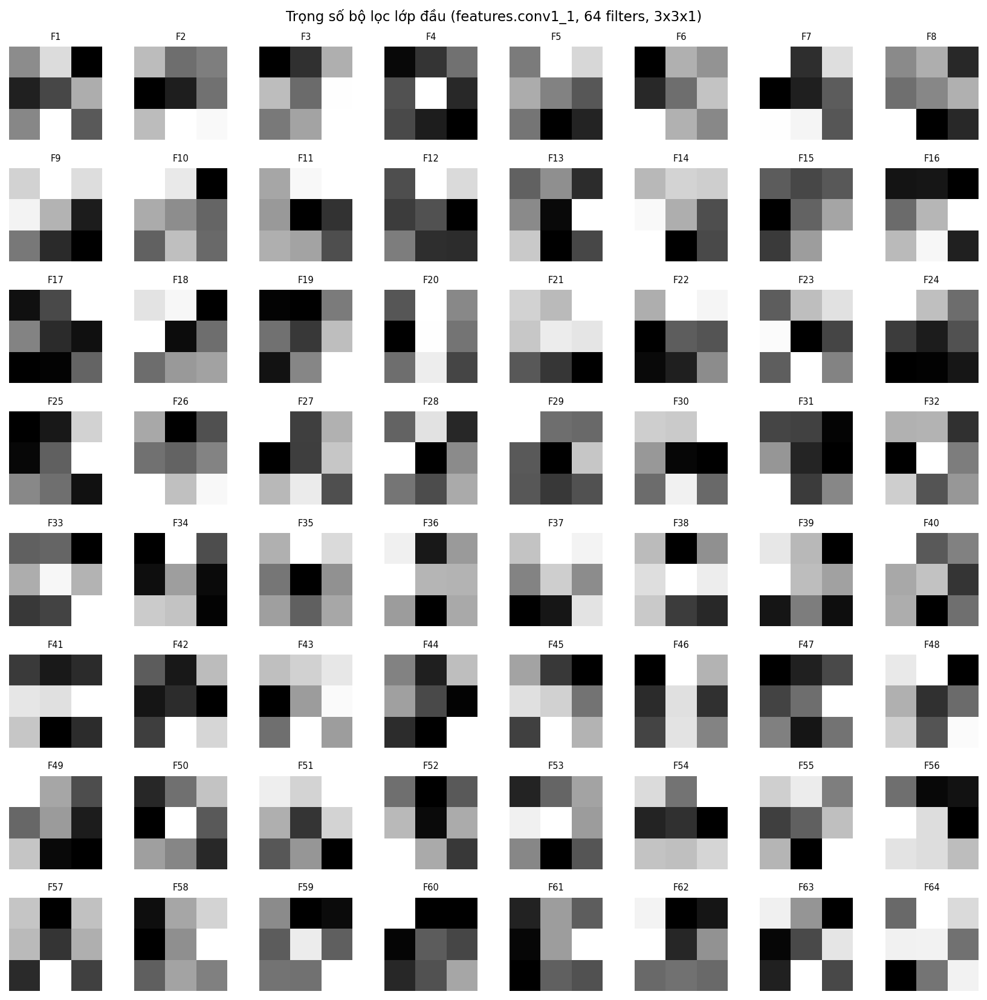
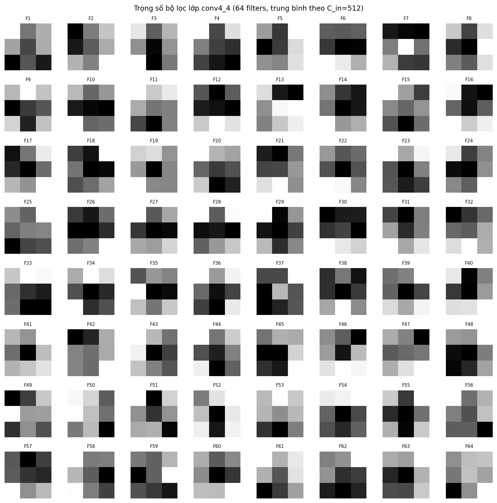
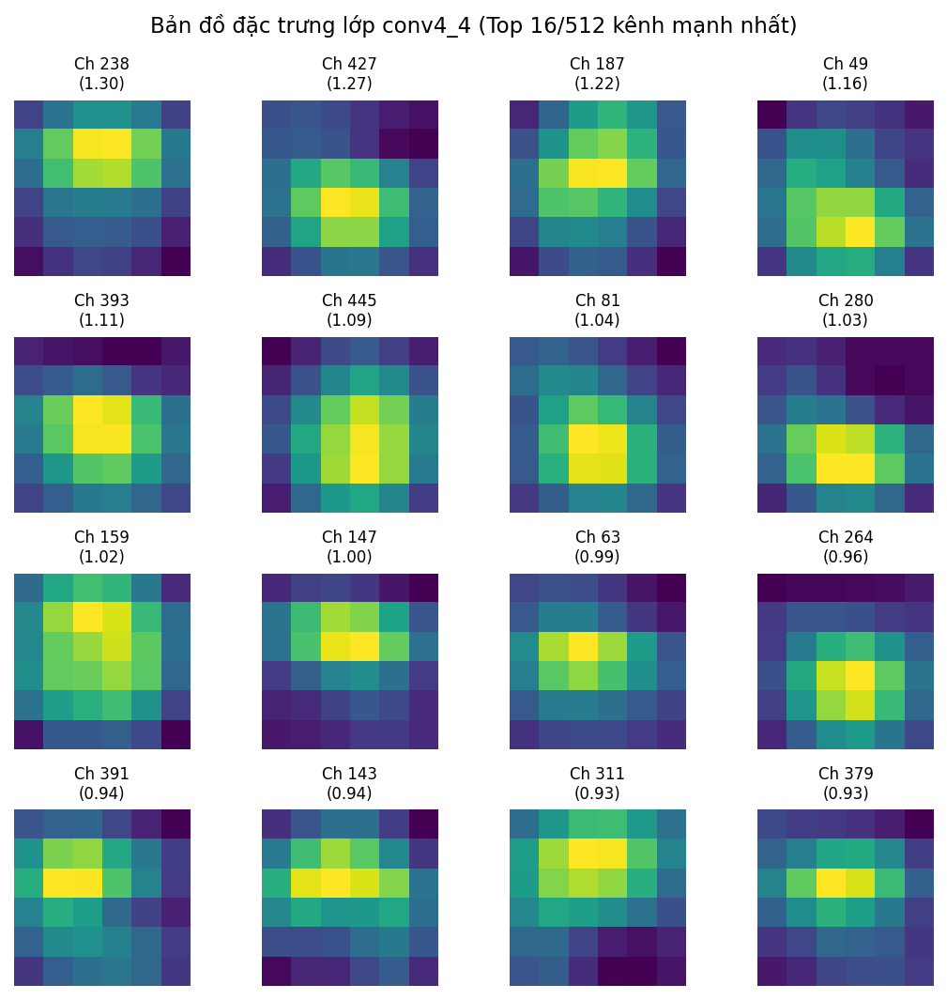
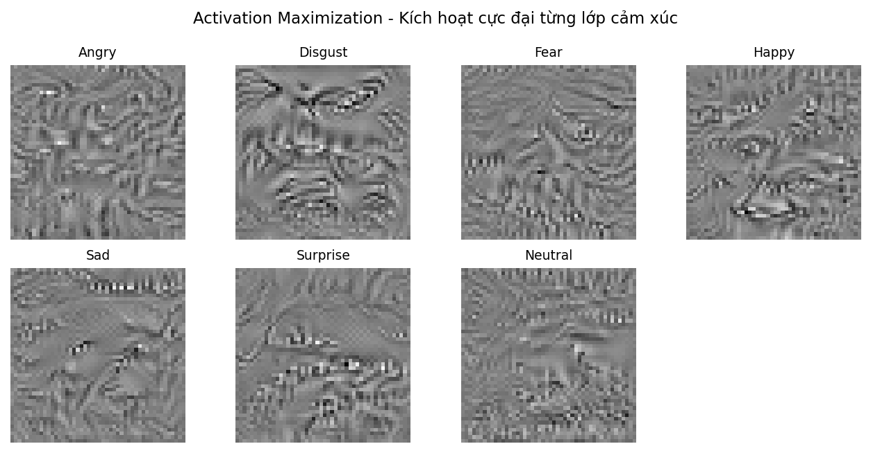
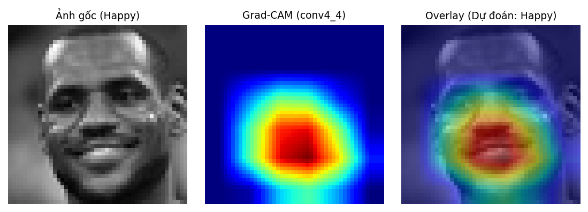
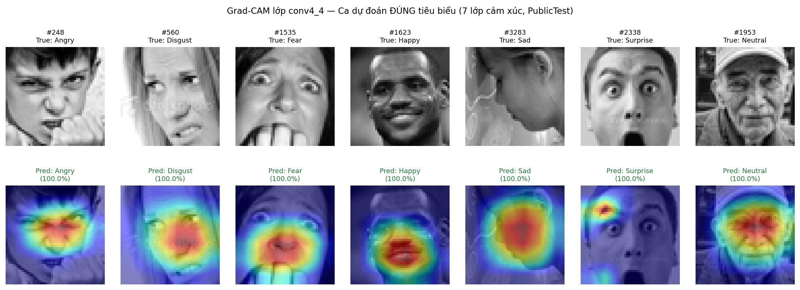
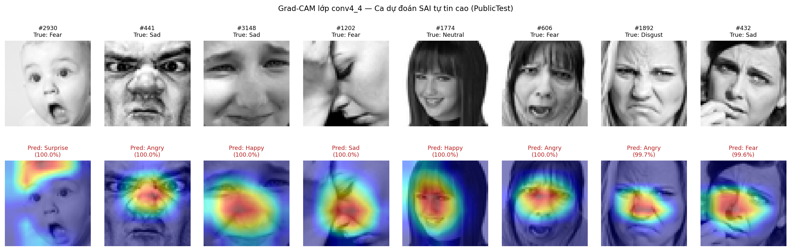

# Chương 6. Trực quan hóa các bộ lọc tích chập

Chương này dựa trên kết quả nhiệm vụ T20. Số liệu trong chương lấy từ `figures/filters_*.{csv,npz}` và `report/tables/T25_filters_stats.csv` (sinh bằng `python src/t25_report_stats.py`).

## 6.1. Mô hình và cách tiếp cận

Đề bài yêu cầu trực quan hóa các bộ lọc của lớp tích chập cuối. Nhóm dùng `E1-014_s0`, seed 0 của kiến trúc `large_bn` và là một trong ba mô hình của ensemble cuối (val acc 0.7086, `results/E1/E1-014_s0/metrics.json`). Mạng có 16 lớp Conv; lớp đầu `conv1_1` có 64 bộ lọc kích thước 3 × 3 × 1, lớp cuối `conv4_4` có 512 bộ lọc kích thước 3 × 3 × 512 và cho bản đồ đặc trưng 512 × 6 × 6 với ảnh vào 48 × 48.

Một bộ lọc 3 × 3 × 512 có 4,608 trọng số, nên vẽ thẳng trọng số không cho biết bộ lọc "nhìn" gì. Vì vậy nhóm trình bày bốn cách, từ đúng chữ đề bài đến dễ diễn giải: (1) trọng số lớp đầu và lớp cuối, (2) bản đồ đặc trưng của lớp cuối trên một ảnh thật, (3) activation maximization, (4) Grad-CAM tại lớp cuối cho các ca đúng và sai. Tất cả sinh bằng `src/visualize_filters.py` (lệnh ở Phụ lục A) và đã được TV2 tái lập trên bản clone sạch: trọng số trùng tuyệt đối với lớp đầu, lệch tối đa 7.6e-10 với lớp cuối, feature map lệch tối đa 5.0e-4, Grad-CAM của cả 15 ca trùng tọa độ đỉnh (biên bản kiểm thử ghi trong `tracking/test_log.csv`).

## 6.2. Trọng số bộ lọc lớp đầu và lớp cuối

**Hình 6.1.** Trọng số 64 bộ lọc 3 × 3 của lớp đầu `conv1_1` (dữ liệu `figures/filters_weights_first.csv`).

**Hình 6.2.** 64 bộ lọc đầu tiên của lớp cuối `conv4_4`, mỗi bộ lọc lấy trung bình theo 512 kênh vào để còn một ô 3 × 3 (dữ liệu `figures/filters_weights_last.csv`).

Ở lớp đầu, cả 64/64 bộ lọc đều có đồng thời trọng số dương và âm, với độ lớn trung bình |w| = 0.1337 và lớn nhất 0.3909. Nhiều bộ lọc có một nửa sáng và một nửa tối theo chiều ngang, chiều dọc hoặc đường chéo (ví dụ F3, F16, F24, F41 trong Hình 6.1), tức là bộ phát hiện cạnh và chênh lệch độ sáng. Đây là kiểu bộ lọc quen thuộc ở lớp đầu của CNN (Zeiler và Fergus, 2014), phù hợp với ảnh mặt người nơi đường viền mắt, lông mày và miệng là những cạnh có độ tương phản cao.

Ở lớp cuối, sau khi lấy trung bình theo 512 kênh vào, độ lớn trung bình chỉ còn 0.000368 (lớn nhất 0.001424), nhỏ hơn lớp đầu khoảng 363.7 lần. Lý do không phải trọng số lớp cuối nhỏ, mà là các trọng số dương và âm trên 512 kênh triệt tiêu nhau khi lấy trung bình. Hình 6.2 vì vậy gần như là nhiễu và không đọc được ý nghĩa: bộ lọc lớp cuối không làm việc trên pixel mà trên tổ hợp của 512 bản đồ đặc trưng trước đó. Đây là bằng chứng định lượng cho việc phải dùng ba cách gián tiếp ở các mục sau.

## 6.3. Bản đồ đặc trưng của lớp cuối

**Hình 6.3.** 16 trong 512 kênh của `conv4_4` có kích hoạt mạnh nhất khi đưa ảnh PublicTest #1623 (nhãn Happy, mô hình đoán đúng) qua mạng; mỗi bản đồ 6 × 6 (dữ liệu `figures/filters_feature_maps.npz`).

Mỗi ô của bản đồ 6 × 6 ứng với một vùng khoảng 8 × 8 pixel trên ảnh gốc. Cả 16/16 kênh có đỉnh kích hoạt nằm trong vùng 4 × 4 ở giữa, không kênh nào đạt đỉnh ở viền ảnh; 13/16 kênh có đỉnh ở hàng 2 đến 4 (đánh số từ 0), tương ứng phần giữa và dưới của khuôn mặt, nơi có mũi và miệng đang cười. Như vậy với ảnh này, các bộ lọc lớp cuối mạnh nhất phản ứng với vùng mặt chứa đặc điểm của nụ cười chứ không phải với nền hay tóc. Đây mới là một ảnh minh họa, không phải thống kê trên toàn tập.

## 6.4. Activation maximization

**Hình 6.4.** Ảnh đầu vào được tối ưu bằng gradient ascent (100 bước) để cực đại logit của từng lớp cảm xúc (dữ liệu `figures/filters_actmax_class.npz`; phiên bản cho 8 bộ lọc của `conv4_4` ở `figures/filters_actmax_filter.png`).

Phương pháp bắt đầu từ ảnh xám nhiễu nhẹ rồi cập nhật chính ảnh theo gradient để làm tăng đầu ra mục tiêu (Erhan et al., 2009; Simonyan et al., 2014). Kết quả là các vân lặp lại dạng nếp nhăn và đường cong ngắn phủ khắp ảnh, không thành một khuôn mặt rõ ràng; ở vài lớp có thể thấy những nét giống mắt hoặc miệng nhưng không đủ để khẳng định.

Nhóm cố ý không diễn giải chi tiết từng ảnh vì lần kiểm thử độc lập cho thấy hình này không tái lập: hai lần chạy trên cùng GPU cho ảnh khác nhau (cuDNN không tất định), và ảnh chạy trên CPU gần như không tương quan với ảnh chạy trên GPU vì nhiễu khởi tạo sinh từ hai bộ sinh số ngẫu nhiên khác nhau. Nói cách khác, ảnh tối ưu phụ thuộc mạnh vào điểm khởi tạo. Kết luận rút ra được chỉ ở mức chung: các nơ-ron lớp cuối phản ứng với kết cấu cục bộ dạng nếp và đường cong hơn là với hình dạng toàn khuôn mặt. Muốn diễn giải sâu hơn cần thêm điều chuẩn ảnh (làm mờ, jitter) và cố định nhiễu khởi tạo; việc này **chưa thực hiện**.

## 6.5. Grad-CAM tại lớp conv cuối

Grad-CAM (Selvaraju et al., 2017) tính gradient của logit lớp được dự đoán theo đầu ra của lớp conv cuối, lấy trung bình gradient theo không gian làm trọng số α của từng kênh, rồi cộng có trọng số các bản đồ đặc trưng và giữ phần dương (ReLU). Bản đồ 6 × 6 thu được phóng lên 48 × 48 để chồng lên ảnh. Trong cài đặt của nhóm, kích hoạt được lấy ngay tại đầu ra `conv4_4`, trước BatchNorm và ReLU, khác bản gốc lấy sau ReLU; cách này vẫn hợp lệ nhưng cần ghi rõ. Các ca minh họa không chọn tay mà lấy từ `results/E7/e7_gradcam_cases.csv` do `src/eval_e7.py` xuất ra trên PublicTest (T18), nên không dùng PrivateTest.

**Hình 6.5.** Grad-CAM của `conv4_4` cho ảnh PublicTest #1623 (Happy, đoán đúng): ảnh gốc, bản đồ nhiệt và ảnh chồng (dữ liệu `figures/filters_grad_cam.csv`).

**Hình 6.6.** Grad-CAM cho 7 ca đoán đúng, mỗi lớp một ca (dữ liệu `figures/filters_grad_cam_correct.csv`).

**Hình 6.7.** Grad-CAM cho 8 ca đoán sai với độ tự tin cao (dữ liệu `figures/filters_grad_cam_wrong.csv`).

**Bảng 6.1.** Tọa độ đỉnh Grad-CAM (hàng y, cột x trên ảnh 48 × 48, đánh số từ 0 ở góc trên trái) của 15 ca.

| Ca | Nhãn thật | Dự đoán | Độ tự tin | Đỉnh (y, x) | Vùng trên ảnh |
|---|---|---|---:|---|---|
| #248 | Angry | Angry | 0.999999 | (20, 27) | giữa hai lông mày, gốc mũi |
| #560 | Disgust | Disgust | 0.999998 | (27, 28) | mũi |
| #1535 | Fear | Fear | 0.999997 | (28, 20) | mũi, môi trên |
| #1623 | Happy | Happy | 1.000000 | (35, 27) | miệng |
| #3283 | Sad | Sad | 0.999763 | (20, 27) | má và mắt (mặt nghiêng) |
| #2338 | Surprise | Surprise | 1.000000 | (11, 11) | lông mày trái, trán |
| #1953 | Neutral | Neutral | 0.999998 | (20, 28) | vùng mắt và gốc mũi |
| #2930 | Fear | Surprise | 0.999997 | (0, 20) | mép trên ảnh, trán |
| #441 | Sad | Angry | 0.999995 | (19, 27) | giữa hai lông mày đang nhíu |
| #3148 | Sad | Happy | 0.999973 | (27, 20) | má, khóe miệng |
| #1202 | Fear | Sad | 0.999967 | (28, 27) | giữa mặt (mặt bị che một phần) |
| #1774 | Neutral | Happy | 0.999985 | (20, 19) | mắt, gò má đang cười |
| #606 | Fear | Angry | 0.999992 | (20, 20) | mắt, lông mày |
| #1892 | Disgust | Angry | 0.997416 | (27, 20) | mũi nhăn |
| #432 | Sad | Fear | 0.995657 | (27, 19) | vùng mắt, tay che miệng |

Nguồn: `figures/filters_grad_cam_correct.csv` và `figures/filters_grad_cam_wrong.csv`; cột "Vùng trên ảnh" do nhóm đọc từ Hình 6.6 và 6.7.

Từ 15 ca có thể rút ra ba nhận xét. Thứ nhất, mô hình nhìn vào khuôn mặt chứ không nhìn vào nền: 6/7 ca đúng và 7/8 ca sai có đỉnh Grad-CAM ở hàng 16 đến 36, dải chứa mắt, mũi và miệng. Trong các ca minh họa, mỗi lớp có vùng đặc trưng khác nhau và hợp với mô tả cơ mặt của Ekman và Friesen (1978): Happy nhìn vào miệng, Disgust nhìn vào nếp nhăn ở mũi, Angry và Neutral nhìn vào vùng giữa hai lông mày và mắt, Surprise nhìn vào lông mày nhướng lên.

Thứ hai, ca sai không phải do mô hình "nhìn lạc chỗ". Độ phủ trung bình của bản đồ (giá trị trung bình sau chuẩn hóa về [0, 1]) ở ca sai là 0.2355, gần với ca đúng là 0.2555, và các ca sai vẫn có độ tự tin rất cao (thấp nhất 0.995657). Mô hình nhìn đúng vùng nhưng vùng đó mang tín hiệu của lớp khác. Ca #441 (Sad đoán Angry) có lông mày nhíu chặt, ca #1774 (Neutral đoán Happy) đang cười, ca #3148 (Sad đoán Happy) có khóe miệng giống nụ cười; với những ảnh như vậy, nhãn của bộ dữ liệu có thể chính là chỗ gây tranh cãi, phù hợp với mức độ chính xác của con người khoảng 65 ± 5% (Goodfellow et al., 2013). Ca #1892 (Disgust đoán Angry) nhìn đúng vào mũi nhăn, đặc điểm mà Disgust và Angry cùng có, khớp với cặp nhầm Disgust → Angry ở Chương 4, mục 4.5.

Thứ ba, hai ca dự đoán Surprise đều có đỉnh ở nửa trên ảnh: ca đúng #2338 ở lông mày (11, 11) và ca sai #2930 (Fear đoán Surprise) ở mép trên ảnh (0, 20). Điều này gợi ý mô hình dựa nhiều vào lông mày nhướng và trán để nhận Surprise, trong khi Fear cũng có lông mày nhướng; đây là một giải thích khả dĩ cho cặp nhầm Fear → Surprise (42 mẫu trên PrivateTest, Chương 4). Đây là nhận xét trên 15 ca minh họa; thống kê Grad-CAM trên toàn PublicTest **chưa thực hiện**.

## 6.6. Tóm tắt

Trọng số lớp đầu là các bộ phát hiện cạnh đọc được trực tiếp; trọng số lớp cuối lấy trung bình theo kênh thì gần như triệt tiêu, nên phải hiểu lớp cuối qua đầu ra của nó. Feature map và Grad-CAM cho thấy lớp cuối phản ứng với vùng mắt, lông mày, mũi và miệng, và mỗi cảm xúc gắn với một vùng hợp lý. Ca sai chủ yếu là ca mô hình nhìn đúng vùng nhưng biểu cảm mơ hồ hoặc nhãn đáng ngờ, không phải ca mô hình dựa vào nền. Activation maximization không ổn định giữa các lần chạy nên chỉ dùng làm minh họa. Phần nhóm chưa làm: so sánh các hình này với baseline hoặc với mô hình chưa huấn luyện, và thống kê Grad-CAM trên toàn tập.
