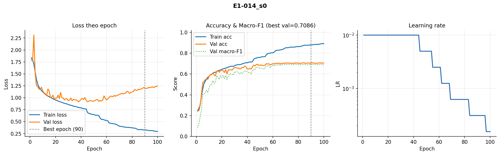

# Chương 7. Thảo luận tổng hợp

## 7.1. Quy mô thực nghiệm

`tracking/experiments.csv` có 92 dòng, gồm 86 run huấn luyện chính thức, 1 lượt đánh giá PrivateTest và 5 run hạ tầng dùng để kiểm thử code và notebook. Trong 86 run chính thức có 80 run Completed, 4 run Aborted (bị dừng tay hoặc ngắt phiên) và 2 run Failed; các run không thành công vẫn được giữ trong bảng và có nhận xét trong nhật ký thực nghiệm. Tổng thời gian huấn luyện cộng từ cột `tong_thoi_gian_s` là 51.8 giờ GPU, chia trên ba loại GPU laptop của bốn thành viên: RTX 3050 (20.2 giờ, hai máy), RTX 3060 (16.5 giờ) và RTX 4060 (15.1 giờ). Số run theo nhóm: baseline 4, E1 30, E2 12, E3 16, E4 10, E5 3, E6 7, E7 4.

**Bảng 7.1.** Tóm tắt bảy nhóm thực nghiệm (độ chính xác trên PublicTest; baseline 0.6815 ± 0.0075).

| Nhóm | Câu hỏi | Kết quả chính | Mang sang E7 |
|---|---|---|---|
| E1 Kiến trúc | Độ sâu, độ rộng, BN, phần phân loại | `large_bn` 0.7060 ± 0.0023 cao nhất; mạng sâu không BN sập về 0.2494; gấp đôi độ rộng giảm còn 0.6654; GAP giữ 0.6839 với 22% số tham số | Giữ `large_bn` |
| E2 Kích hoạt | ReLU so với các hàm khác, vanishing gradient | Họ ReLU tốt nhất (`leaky_relu` 0.6935, `gelu` 0.6918, 1 seed); Sigmoid không BN 0.2494, gradient lớp đầu nhỏ hơn lớp ra khoảng 2.5 triệu lần | Thử LeakyReLU, không giữ |
| E3 Tối ưu | Optimizer, lịch lr, batch size | Chỉ `bs_64` vượt std (0.6924); SGD lr 0.03 sập; AdamW giảm macro-F1 | Thử batch 64, không giữ |
| E4 Điều chuẩn | Augmentation, dropout, weight decay, label smoothing | Khoảng cách train/val tại best epoch: không augmentation 28.09 điểm %, `flip_affine` 4.72 điểm %; chưa kỹ thuật nào cải thiện nhất quán | Dùng trong `baseline_best` |
| E5 Mất cân bằng | CE, trọng số lớp, WeightedRandomSampler | Sampler giữ accuracy (0.6824) và tăng macro-F1 +3.01 điểm %; trọng số lớp giảm accuracy 2.03 điểm % | Thử sampler, không giữ |
| E6 Transfer | ImageNet có giúp ảnh xám 48 px không | VGG16 96 px 0.6977 nhưng nặng 22.9 lần baseline; ResNet18 fine-tune 0.6874; đóng băng backbone 0.4570 | Không dùng |
| E7 Mô hình cuối | Ghép cấu hình, TTA, ensemble | Không cấu hình ghép nào thắng `large_bn`; ensemble 3 seed + lật ngang 0.7250 | Mô hình cuối |

## 7.2. Cách hiểu của nhóm về kết quả

Thứ nhất, với FER2013, điều kiện để mạng sâu học được quan trọng hơn bản thân độ sâu. Cùng 16 lớp Conv, `large` không BN đoán toàn lớp Happy (0.2494), còn `large_bn` cho kết quả tốt nhất dự án. Nhóm tách được nguyên nhân bằng các run đổi từng yếu tố (Bảng 3.5): khởi tạo mặc định của PyTorch có phương sai nhỏ hơn Glorot của Keras khoảng 3 lần nên gradient tới lớp đầu gần bằng 0, và BatchNorm loại bỏ hẳn sự phụ thuộc vào khởi tạo. Bài học là không thể chép nguyên siêu tham số của một framework sang framework khác mà kỳ vọng cùng kết quả.

Thứ hai, chênh lệch nhỏ hơn độ lệch chuẩn giữa các seed không phải là cải thiện. Baseline ba seed dao động ± 0.0075, nên phần lớn biến thể một seed của E2 đến E6 chỉ "nhỉnh hơn" trong phạm vi nhiễu. Bằng chứng rõ nhất là Bước 1 của E7 (Bảng 3.10): batch 64 (+0.0109 trên baseline) và LeakyReLU (+0.0120 trên baseline) đều làm `large_bn` giảm khi ghép vào. Tác dụng của một siêu tham số phụ thuộc kiến trúc, nên nhóm không cộng dồn các mức cải thiện mà kiểm lại từng tổ hợp theo luật chọn đặt trước trong `configs/E7_final.json`.

Thứ ba, ensemble là cách cải thiện rẻ và chắc chắn nhất. Trung bình xác suất của ba seed tăng accuracy từ 0.7060 lên 0.7236 và giảm NLL từ 1.2175 xuống 0.9780 mà không phải huấn luyện thêm gì ngoài hai seed đã chạy để đo độ ổn định; thêm lật ngang lúc suy luận đưa lên 0.7250. Ba mô hình cùng kiến trúc nhưng khác seed mắc lỗi ở những ảnh khác nhau, và việc lấy trung bình làm dịu các dự đoán quá tự tin.

Thứ tư, lỗi còn lại chủ yếu nằm ở bản chất dữ liệu. Trên PrivateTest, cụm Angry, Fear, Sad, Neutral chiếm 665/946 lỗi (70.3%), Fear chỉ có recall 51.52% (Chương 4, mục 4.5). Grad-CAM ở Chương 6 cho thấy ở các ca sai, mô hình vẫn nhìn vào mắt, lông mày, miệng; nhiều ảnh sai có biểu cảm mà chính nhóm khi nhìn cũng thấy gần với lớp được dự đoán hơn lớp được gán nhãn. Với độ chính xác của con người khoảng 65 ± 5%, nhóm cho rằng phần lớn sai số còn lại khó giảm thêm bằng cách thay kiến trúc mà cần dữ liệu tốt hơn.

## 7.3. Các trường hợp không như kỳ vọng

1. Bỏ BatchNorm ở baseline 6 Conv lại cao hơn có BN (`baseline_no_bn` 0.6941 ± 0.0033 so với 0.6815 ± 0.0075). Nhóm kỳ vọng BN luôn có lợi; kết quả cho thấy BN chỉ là điều kiện cần với mạng sâu.
2. Mạng rộng gấp đôi (`baseline_w2`, 14.0 M tham số) thấp hơn baseline (0.6654), không phải do quá khớp mà do chưa hội tụ sau 100 epoch với lr 0.01.
3. Sigmoid có BN vẫn chỉ đạt 0.4765 ± 0.0220 dù gradient lớp đầu đã hồi phục từ epoch 10. Nút thắt lúc này không còn là vanishing gradient mà là tốc độ học quá chậm, khiến lịch lr và early stopping dừng sớm.
4. Trọng số ImageNet giúp hội tụ nhanh (ResNet18 đạt 0.5612 sau epoch 1 so với 0.2862 khi học từ đầu) nhưng không tăng accuracy cuối một cách rõ ràng, và đóng băng backbone chỉ đạt 0.4570. Đặc trưng ảnh màu tự nhiên không chuyển tốt sang khuôn mặt xám 48 px.
5. Trọng số lớp giảm accuracy 2.03 điểm %, trong khi WeightedRandomSampler giữ được accuracy và tăng macro-F1; khi ghép sampler vào `large_bn` (E7-003_s0), macro-F1 lại thấp hơn mốc (0.6874 so với 0.6953).
6. TTA mười vùng cắt làm giảm accuracy (ensemble 0.6991 so với 0.7236 khi không TTA), dù các vùng cắt nằm trong biên độ augmentation lúc huấn luyện. Nhóm chưa kiểm chứng nguyên nhân (Chương 4 nêu giả thuyết).
7. Kết quả PrivateTest (73.64%) cao hơn PublicTest (72.50%). Điều này giảm lo ngại rằng việc chọn cấu hình nhiều lần trên PublicTest đã làm kết quả lạc quan quá mức, nhưng chênh lệch giữa hai tập 3,589 ảnh cũng nằm trong phạm vi biến động do mẫu.
8. Disgust, lớp hiếm nhất, đạt F1 80.39% trên PrivateTest, cao thứ ba trong bảy lớp, trong khi nhóm kỳ vọng đây là lớp yếu nhất. Fear, lớp có nhiều ảnh, mới là lớp khó nhất.

## 7.4. Hạn chế

1. Phần lớn biến thể E1 đến E6 chỉ chạy một seed; các kết luận "nhỉnh hơn baseline" ở đó chỉ có giá trị định hướng. Bước sàng lọc của E7 cũng chỉ một seed.
2. Các run chạy trên ba loại GPU khác nhau. Với cấu hình ổn định, độ lệch khi chạy lại nằm trong độ lệch chuẩn baseline, nhưng với cấu hình bất ổn như Sigmoid, cùng seed 0 cho 0.4511 trên RTX 3060 và 0.4890 trên RTX 4060.
3. Mô hình cuối quá khớp rõ: Train − Val (epoch cuối) 0.1952, val loss thấp nhất quanh epoch 40 rồi tăng trong khi val acc vẫn nhích lên (Hình 7.1). Các kỹ thuật điều chuẩn của E4 chưa được thử trên `large_bn`.
4. PublicTest được dùng cho cả early stopping, giảm lr và chọn cấu hình, nên accuracy PublicTest của mô hình cuối có thiên lệch lạc quan; chỉ con số PrivateTest là ước lượng không thiên lệch.
5. Activation maximization không tái lập giữa các lần chạy; Grad-CAM mới phân tích định tính trên 15 ca.
6. Ảnh không được căn chỉnh khuôn mặt, và nhóm không xử lý nhiễu nhãn của FER2013.
7. Các chỉ số đếm trong Bảng 1.2 ở Chương 1 (commit, lần kiểm thử, run huấn luyện) chỉ phản ánh thô khối lượng công việc và chưa phân biệt độ lớn từng commit hay thời lượng từng run; do đó nhóm dùng để đối chiếu minh bạch và thống nhất mức đóng góp bằng nhau 25.0% khi mọi thành viên đều hoàn tất 100% nhiệm vụ được phân công.

**Hình 7.1.** Loss, accuracy, macro-F1 và learning rate theo epoch của `E1-014_s0` (một trong ba mô hình của ensemble cuối). Đường đứt nét là epoch tốt nhất (90). Dữ liệu `results/E1/E1-014_s0/history.csv`, sinh bởi `src/visual/plots.py`.

## 7.5. Hướng cải tiến

1. Điều chuẩn cho `large_bn`: weight decay lớn hơn, label smoothing, random erasing, hoặc mixup và cutmix, chạy đủ ba seed; chọn checkpoint có xét cả val loss để giảm quá khớp.
2. Chạy thêm seed cho các biến thể có tiềm năng nhưng mới một seed (`leaky_relu`, `gelu`, `bs_64`, WeightedRandomSampler, `resnet18_96_ft`) trước khi loại hẳn.
3. Ensemble khác kiến trúc, ví dụ `large_bn` cùng `resnet18_96_ft` hoặc `baseline_best`, vì mô hình khác kiến trúc thường mắc lỗi khác nhau hơn mô hình khác seed.
4. Căn chỉnh khuôn mặt theo mắt trước khi huấn luyện, và dùng nhãn được gán lại của FER+ (Barsoum et al., 2016) hoặc hàm mất mát chịu nhiễu nhãn để xử lý các ca nhãn mơ hồ như Chương 6 đã chỉ ra.
5. Tách một phần Training làm tập chọn cấu hình riêng, để PublicTest chỉ dùng cho early stopping và kết quả validation bớt thiên lệch.
6. Chưng cất tri thức (knowledge distillation) từ ensemble sang `baseline_gap` (1.28 M tham số) để có mô hình nhỏ chạy nhanh khi triển khai.
